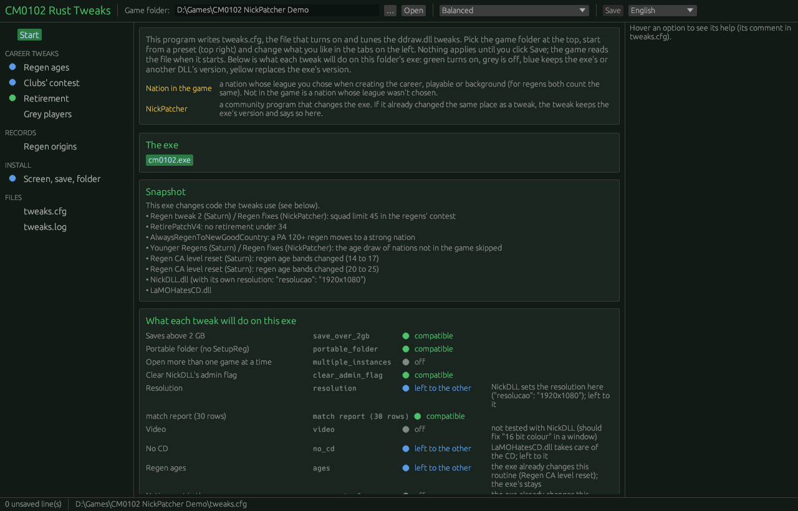
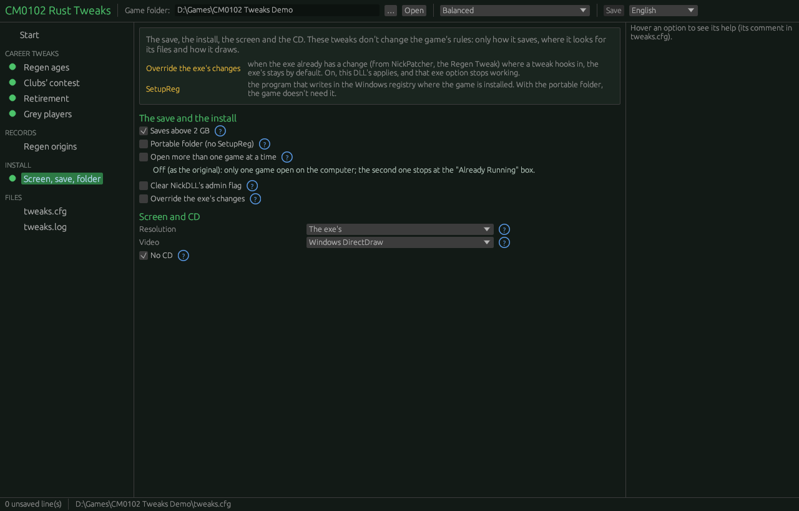
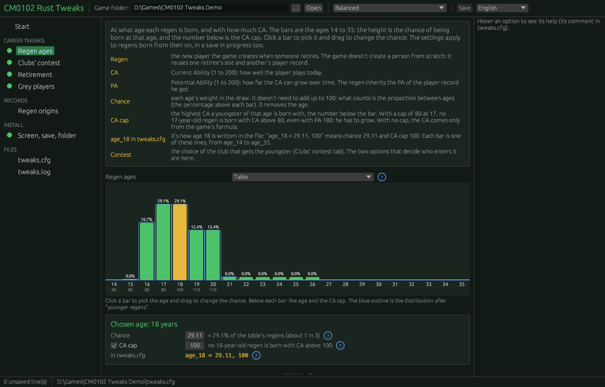
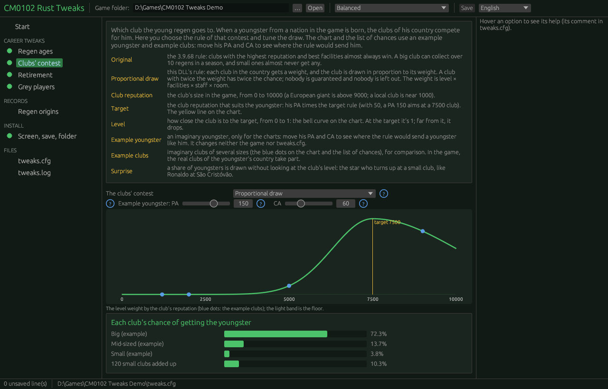
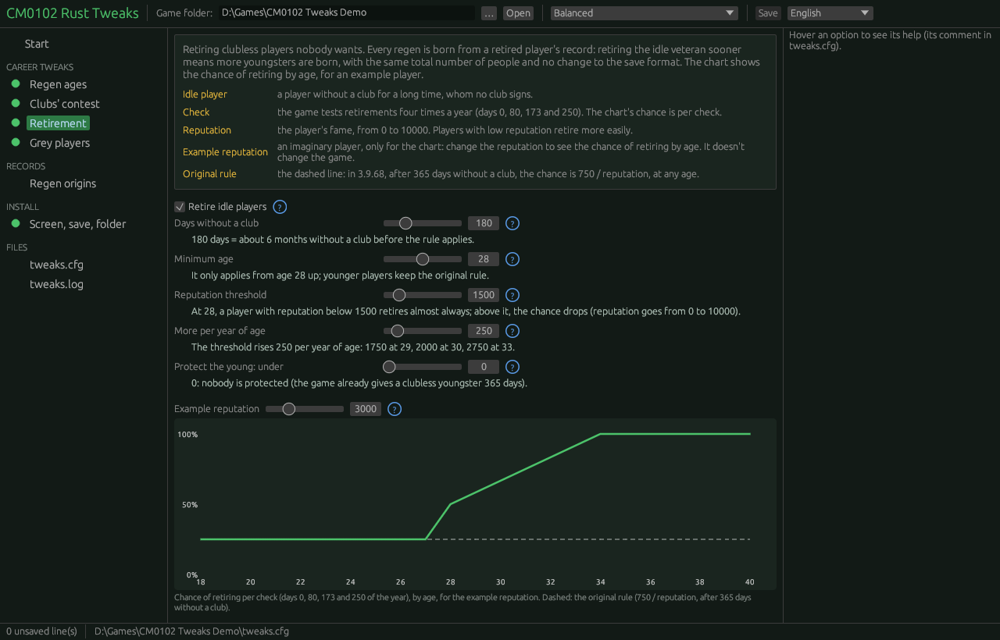
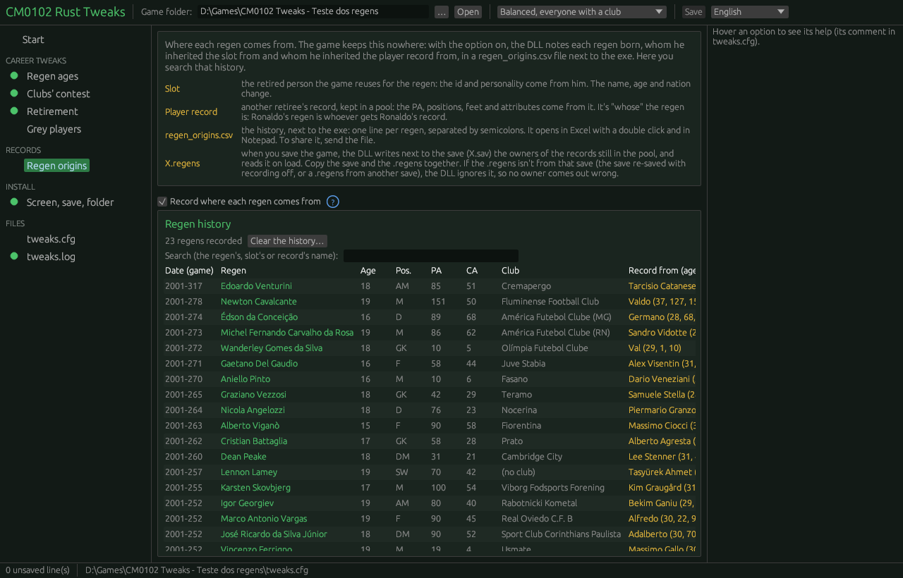
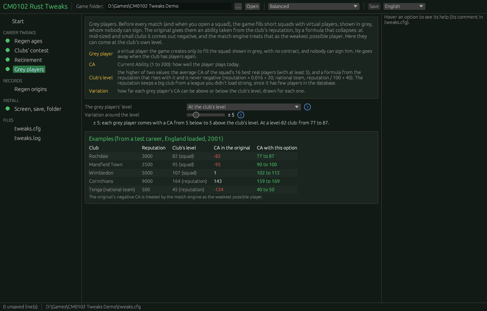

# CM0102-Rust-Tweaks

*Versão em português: [README.pt.md](README.pt.md)*

Tweaks for **Championship Manager 01/02 (3.9.68)** in a `ddraw.dll`, without changing the exe. Made with AI, from the Rust rewrite of the game (the CM0102 project). It runs with the original exe or the NickPatcher ones; each tweak checks the exe's code before turning on.

Each tweak has its own switch in `tweaks.cfg`, next to the exe. **They all start off:** without the `.cfg`, or without the line, the DLL changes nothing in the game. A configurator (the options picker) will read and write that same file.

| Switch | What it does |
|---|---|
| `save_over_2gb = 1` | **Saves above 2 GB** (up to 4 GB), the same fix as save2gb: the three container routines (`zopen` 0x9326e0, `zseek` 0x933080, `ztell` 0x933170) go to the ones in `src/conteiner.rs` |
| `portable_folder = 1` | **No SetupReg**: the game's registry `Location` (the folder it switches to at start) is the exe's own folder, through the exe's `RegOpenKeyExA`/`RegQueryValueExA` imports (`src/pasta.rs`); nothing is written to the registry |
| `multiple_instances = 1` | **Several games open, one per folder**: the single-game lock (the mutex "Championship Manager 2001/02 Process", 0x9f183c) gets, in place of "Process", 7 digits taken from the exe's folder; games from different folders (3.9.68 and CLZ, two careers in two copies) run at the same time, and two from the same folder are still blocked (they would share the temporary files and the save). With `portable_folder = 1` |
| `clear_admin_flag = 1` | **No "run as administrator"**: removes the `RUNASADMIN` that NickDLL writes for the exe in `HKCU\...\AppCompatFlags\Layers` (only that word, only for this exe; `WIN95` stays, since CLZ 2026 V6.1 crashes creating a career without it), from the next start on |
| `video = window` | The **CM0102 project's video layer** (a copy of `video.rs`, `apresentacao.rs`, `reducao.rs` and `win.rs` from there): the game draws to our own DirectDraw and the picture goes to an ordinary window. Print Screen works, the window resizes with sharp scaling and Windows' video mode never changes (`ChangeDisplaySettingsA` does nothing). Works at 800×600 |
| `resolution = 1080` | The CM0102 project's **1920×1080 resolution**, in memory (`src/trocas.rs`, generated by `tools/gerar_trocas.py` from the difference between that project's portable and 1080 exes), with `video = window` and the 30-row limit of `Area::init` (0x402ac0; without it, an old match's report shows the "Area.cpp 507" box). Does what is possible: changes the places that are as in 3.9.68, keeps those the exe already has and only refuses if one holds another patch; with CLZ 6.1's NickDLL handling the resolution, left to it. The 30-row limit goes in with any high resolution. See [docs/COMPATIBILIDADE.en.md](docs/COMPATIBILIDADE.en.md) |
| `no_cd = 1` | **No CD**: the 33 CD checks always pass (as in the CM0102 project's portable exe). Check by check: those the exe already has are kept; with `LaMOHatesCD.dll` next to the exe, left to it |
| `regen_origins = 1` | **Where each regen comes from**: `regen_origins.csv`, next to the exe, gets one line per regen born, with his name, age, position, PA, CA and the club that won the contest (or "no club"), and whom he inherited the slot from (id and personality) and the player record from (PA, positions and attributes), with the owner's name, age, CA and PA at retirement. Each line has the game date, the computer's date and the career (the save). The game keeps this link nowhere; the configurator searches by name ("Ronaldo's regen") and clears the history. When you save, an `X.regens` next to the save keeps the owners of the records still in the pool, so a loaded career goes on knowing them; the CSV opens in Excel (`src/origem.rs`, checked against the save by `tools/conferir_origens.py`) |
| `grey_players = squad` | **Grey players at the club's level**: the virtual players the game adds to fill a short squad (`VIRTUAL_STAFF`, shown in grey, nobody can sign them) get the club's level ± half of `grey_players_spread` (default 10, that is ± 5). The level is the higher of the average CA of the squad's 16 best real players and a formula from the reputation that is never negative. In the original, the CA comes from the reputation by a formula that collapses below 5000 and turns negative at mid-sized and small clubs (63% of grey players in a test career). One hook at 0x90e6d4 in `create_virtual_player` 0x90e0a0 (`src/cinzentos.rs`) |
| `ages = custom` | **Regen ages** from a table (§ Ages) |
| `retire_idle_players = 1` | **Retiring idle players**: a player without a club that nobody wants retires sooner, and his record becomes a regen (§ Retiring idle players) |
| `rule = new` | The **clubs' contest** for a youth regen (`PLAYER_REGEN::pick_best_club_for_player`, 0x7ad0e0) becomes a proportional draw (§ The new rule). The original rule is in [docs/DISTRIBUICAO_DOS_REGENS.en.md](docs/DISTRIBUICAO_DOS_REGENS.en.md) |

When this repository goes public, it replaces `CM0102-Rust/cm0102-save2gb`, which will point here: every future change lives here. That's why the save fix is in this DLL; with a single DLL, nobody needs to chain two `ddraw.dll` files.

The plan is in [ROADMAP.md](ROADMAP.md).

**Status: work in progress.** Version 1.0 is a pre-release ([Releases](https://github.com/CM0102-Rust/CM0102-Rust-Tweaks/releases): the DLL, the configurator, `tweaks.cfg` and the guides, plus the source code): improvements will come, and it needs testing by people who play. **Always back up your saves** before trying it, and send `tweaks.log` if something goes wrong. It has run in automatic careers of up to ten seasons on 3.9.68 and five on CLZ, with no crash; the numbers are in [docs/TESTES.en.md](docs/TESTES.en.md). The configurator is described in [docs/CONFIGURADOR.en.md](docs/CONFIGURADOR.en.md).

**Install:** copy `ddraw.dll`, `tweaks.cfg` and `tweaks-config.exe` into the folder of `cm0102.exe` and open the configurator. **Remove:** delete `ddraw.dll`.

### Screenshots

| | |
|---|---|
|  |  |
|  |  |
|  |  |
|  | |

## Files

| File | What |
|---|---|
| `src/lib.rs` | The DLL: forwards `DirectDrawCreate` (to `ddraw_chain.dll` or the Windows one; with `video = window`, its own video layer), reads `tweaks.cfg`, checks the signatures and turns each tweak on |
| `src/conteiner.rs` | The saves above 2 GB container (a copy of `rust/src/conteiner.rs` from the CM0102 project; stable since save2gb) |
| `src/partes.rs` | The parts, the signatures and the known cases (also used by the configurator) |
| `src/pasta.rs` | `portable_folder` and `clear_admin_flag` |
| `src/cinzentos.rs` | `grey_players`: the grey players' CA from the club's level |
| `src/video.rs`, `src/apresentacao.rs`, `src/reducao.rs`, `src/win.rs` | The `video = window` video layer (copies of the CM0102 project's files: change them there and copy here) |
| `src/trocas.rs` | The `no_cd` and `resolution` changes (generated by `tools/gerar_trocas.py`) |
| `configurador/` | The configurator, `tweaks-config.exe` (Rust + egui, a single exe): edits `tweaks.cfg` with sliders, charts and each tweak's state on the exe (`cd configurador && cargo build --release`) |
| `docs/CONFIGURADOR.en.md`, `docs/configurador_maquete.html` | The configurator design and the interactive mock-up (opens in a browser) |
| `docs/GUIA_DAS_CHAVES.en.md` | **The key guide for players:** each option, what it does, when to use it and what happens in the game (generated by the configurator, `tweaks-config.exe --guia en`) |
| `docs/COMPATIBILIDADE.en.md` | What each setting does with the Regen Tweak, NickPatcher, NickDLL and LaMOHatesCD (✅ ⚠️ 🔁 ❓) and what CLZ 6.1's NickDLL changes |
| `docs/NICKPATCHER.en.md` | **For NickPatcher users:** each of its options that changes the same place as a tweak, what works together and what each choice causes |
| `docs/TESTES.en.md` | The in-game tests and each run's results (stability, saves, snapshot, regens) |
| `tweaks.cfg` | The options, in English and commented (it's the community's file); goes next to the exe |
| `tools/calibrar.py` | Out-of-game simulator: a country's real clubs, read from a save, contest several seasons of youngsters under the original rule and the new one (with the `.cfg` age table) |
| `tools/simula_nota.py` | The document's made-up clubs example (§7) |
| `tools/regens_por_clube.py` | Regens per club in a save, by reputation and Training band |
| `tools/sav.py` | Reads the items of a `.sav` |
| `tools/gerar_trocas.py` | Generates `src/trocas.rs` from the difference between the CM0102 project's `cm0102.exe`, portable and 1080 exes |
| `tools/temporadas.py` | A long career's per-season table (the log's `season` and `regen` lines) |
| `tools/gerar_referencia.py` | Generates `src/referencia.rs` (the hash of each 3.9.68 function and block) for the DLL's snapshot |
| `tools/ler_retrato.py` | Names the snapshot lines in `tweaks.log` |
| `tools/retrato_exe.py` | A snapshot of an exe against the original 3.9.68: what changed, function by function (`tools/mapa_funcoes.csv` and the community map's names), new sections and the jumps into them, and each change's name from NickPatcher's catalogue (`MiscPatches.zip`); anything not in the catalogue shows as an unnamed change. `python tools/retrato_exe.py original.exe other.exe --catalogo MiscPatches.zip --nomes cm0102-function-map/map --saida snapshot.md` |

Build: `cargo build --release` (output in `target/i686-pc-windows-msvc/release/ddraw.dll`).

Each tweak checks two signatures (FNV-1a) before turning on:
- **the edges**, what the hook uses (the entry, the return point, the routines it calls). If they don't match, the tweak never turns on;
- **the body**, the original routine the tweak replaces. If only the body differs, the exe already has another change there and, **as in the rest of the project, the exe's routine stays**, with a note in `tweaks.log`. `override_exe_changes = 1` overrides it.

On the exes we have [observed]:

| Exe | Save | Ages | Ages (not in the game) | Idle players | Contest |
|---|---|---|---|---|---|
| `cm0102.exe`, `cm0102-1080.exe`, portable | on | on | on | on | on |
| the three CLZ exes | on | exe's | exe's | on | exe's (Regen Tweak) |
| `cm0102_GDI.exe` | never | never | never | never | never |

"Exe's" becomes "on" with `override_exe_changes = 1`. The log names the xeno/Saturn Regen Tweak when it finds it.

## Ages

The youngster's age is drawn in a block of `regenerate_as_youth_player` (0x7ac597..0x7ac6f6), which also caps CA by age. With `ages = custom`, the DLL replaces that block with a small machine-code stub that calls `sortear_idade`: the age comes from the `.cfg` table `age_NN = chance, CA cap` (ages 14 to 35), and that age's CA cap is applied, except `ca_cap_skip`% of the time. The age then goes through the rest of the routine as in the original (birth year, attribute adjustments by age). And `contest_max_age` (default 18) replaces the "under 19 enters the contest" cut (the byte at 0x7ace69).

- **Younger regens, the idea of petermf23** (item 14 of his Polish divisions mod for 3.9.60): a youngster drawn at `younger_from_age` (22) or older is made `younger_by` (6) years younger (22 → 16, 26 → 20), so he gets a development period. The rule applies after the draw, in the table and for nations not in the game. In playable nations, 22 or older is very rare (about 0.2%); for nations not in the game, the original draws mostly 23 to 27, and that's where the rule matters (and the younger age also leads to the CA formula for younger players). There, with `ages_out_of_game = original`, the DLL reproduces the original draw and applies the rule. On in the shipped `.cfg`; `younger_by = 0` turns it off.
- **Who goes to the contest** (`unattached`): in the original, a youngster from a nation in the game goes to the contest only when under 19 (`contest_max_age` + 1), and then 3 times in 4; the rest start without a club even when the country's clubs have room (about 44%). With `unattached = only_if_no_room` (Lucas's suggestion, 11/01/2026), the DLL removes the age cut and the 1-in-4 draw (0x7ace6a and 0x7ace89, by NOP): every youngster from a nation in the game goes to the contest, and starts without a club only when no club in the country is eligible (full squad or, with `rule = new`, the season cap). Nations not in the game keep the original path. Default: `original`.
- **"Nation in the game"** is one whose league was picked when starting the career, playable or background: for regens both count the same (the `NationLeagueSelected` byte, nation +0x11c, is 2 for playable and 1 for background, written by 0x827110; the regen code only checks it isn't 0, at 0x7ace81). "Not in the game" is a nation whose league wasn't picked.
- The `.cfg` default table is the original distribution: 16 to 20 almost always (17 and 18 at 29% each), 15 and 21 to 26 very rare.
- A deliberate difference: the CA cap becomes one value per age. In the original, the cap at 17 and 18 depends on the band that was drawn (80 or 90, 100 or 110).
- Nations not in the game with fewer than 350 people in the database (+0x88) have their own draw in the original: mostly 23 to 27, sometimes 17 to 23, and there the age picks the CA formula (younger, lower CA), with no cap. With `ages_out_of_game = table` they use the table too (0x7abeb1..0x7abeea); the CA formula by age stays the original one, and the table's caps don't apply there. The default is `original`.
- **The CLZ exes already change the ages** [observed in the bytes]: the very rare 15-to-18 band becomes 14 to 17 (0x7ac5b1), the rare 21-to-26 band becomes 20 to 25 (0x7ac699), and nations not in the game use the playable nations' draw (`jmp` at 0x7abeab). They also carry the full Regen Tweak (0x7ad1bf `0x2d` and 0x7a6f48 `jl`) and another change to the youngsters' nationality switch (0x7abcd7..0x7abd1c). By default the DLL leaves those routines to the exe.

## Retiring idle players

Every regen is born from a retired player's record. So retiring players nobody wants sooner means more regens a year. The total population doesn't change, and neither does the save format.

**How the original game retires players** (on days 0, 80, 173 and 250 of the year, `find_new_retirements` 0x7a5790) [observed in the code]:

1. **The age rule** (`player_regen_check_retirement` 0x7a7310) only applies past the position's age limit, taken from the player record:

   | Position | Limit |
   |---|---|
   | goalkeeper | 34 |
   | striker, or attacking midfielder | 30 |
   | the others | 31 |

   Past the limit, he retires, among other cases:
   - over 45;
   - over 34 and 65+ days without a club: in practice, automatic;
   - by the score (1 − 0.075 × years past the limit) × reputation, with random draws.
2. **The unemployed rule** (`player_regen_check_unemployed_retirement` 0x7a8050), when the first one didn't retire him. **It ignores age**: 365+ days without a club, he retires with random(current reputation) < 750. Even a 22-year-old regen nobody signed can go this way. Anyone on a club's shortlist doesn't retire.

**There's a queue:** a retiring player goes to a list with a date (today, for the unemployed rule; usually the end of the season, for the age rule). On that date his record goes to the pool, his slot joins the regen queue (today, or in 1 to 65 days from age 30), and the regen is born when there's a record. So one more retirement means one more regen, a few weeks later.

**What `retire_idle_players = 1` changes** (0x7a8050 replaced; the age rule stays as it is), for players only:

| Switch | Default | What |
|---|---|---|
| `idle_days` | 180 | days without a club (the original: 365) |
| `idle_min_age` | 28 | from this age the new rule applies; below it, the original one |
| `idle_rep` | 1500 | the draw threshold at `idle_min_age` (the original: 750) |
| `idle_rep_per_year` | 250 | how much the threshold rises per year of age |
| `protect_young_unemployed` | 0 | below this age, the unemployed rule never retires him; 0 = no protection (the default: in a test career, protecting under-23s cut most of the recycling into regens, and the original already gives a clubless youngster 365 days) |

He retires when random(current reputation) < `idle_rep` + `idle_rep_per_year` × (age − `idle_min_age`). Example, with reputation 3000:
- at 28, 50% per check;
- at 31, 75%;
- at 34, 100%.

A good unemployed 28-year-old (reputation 6000) gets 25% per check and has time to find a club.

**On the CLZ exes, the rule barely acts:** NickPatcher skips, in the retirement search (0x7a5790), everyone under 34 (a `jmp` at 0x7a5806 into the `.nick` section), and from 34 on the game's age rule already retires anyone clubless for more than 65 days. In a two-season CLZ career it retired no one [observed]. `tweaks.log` says so at start-up. Managers without a club keep the original rule, and anyone on a shortlist still doesn't retire.

## The new rule

The eligible clubs are the same as in the original:
- the youngster isn't foreign at the club;
- it isn't a B team;
- it isn't barred by the Basque rule;
- the club can approach the player;
- squad below the limit.

Each club gets a **weight**, and the club is drawn **in proportion to its weight**, using the game's own random generator. No weight at all: the youngster stays clubless, as in the original.

**The random sequence changes:** the new rule uses 2 draws from the generator per youngster; the original uses 1 per eligible club (and sometimes more, in the score bonuses). The age table also uses other draws. For a mod that's expected, but a career with the same seed (`-seed`) won't come out the same as the game without the DLL.

    weight = (level × facilities × staff × room) ^ temperature

| Factor | Formula | Settings |
|---|---|---|
| Level | bell curve of the club's reputation around the target = target_k × PA (or the mix with CA); **asymmetric**: above the target the width is `sigma`, below it's `sigma_below`, narrower, because a country's hundreds of small clubs, added up, would take the good youngsters | `target_k`, `target_ca`, `sigma`, `sigma_below`, `level_floor` |
| Surprise | for `surprise`% of the youngsters the level doesn't count, and only clubs in a competition running in the game take part: the good youngster born at a small club; the market moves him later | `surprise` |
| Facilities | facilities_base + facilities_k × Training | `facilities_base`, `facilities_k` |
| Staff | from staff_min to staff_max by the best "Working with Youngsters" among the manager and the 5 coaches. Same for AI and human | `staff_min`, `staff_max` |
| Room | ((squad_limit − squad) / squad_limit) ^ squad_exp; with the squad at the limit, weight 0 | `squad_limit`, `squad_exp` |
| Per-club cap | weight 0 if the club already got `season_cap` regens in the last 365 days: the DLL keeps every youngster it handed out, with the date, and counts even those the club has loaned out, sold or sent to its B team; after loading a save (the list doesn't go into the save), the count from the save itself applies: the regen bit and the date he joined the club | `season_cap` |
| Outside the competitions | the weight of a club whose division doesn't run in the game (not even as a background league) is multiplied by `outside_competitions` (1 = the same as the others, the default; 0 = never). With few leagues loaded, most of a country's clubs are outside, and 1 may suit better; with many, a low value keeps the squads of the leagues you play fuller (TESTES §4.5). The surprise already leaves them out | `outside_competitions` |
| Temperature | exponent: 1 proportional, higher more predictable, lower more random | `temperature` |

With `log = 1`, `tweaks.log` records what happens, one line per event: `tick` (the game date every month, with a summary, to know the career is moving even when no tweak writes anything), `regen` (each contest youngster, by the new rule, the original or the exe's), `birth` (each birth through the age table), `idle` (each retirement by the idle rule), `season` (every July, the population: squads, clubless, regens, the club with most regens, PA ≥ 150), `hang` and `msgbox`, `check` (the hooks checked after the exe's DLLs load) and `crash` (the first access violation, with address and registers). `tools/comparar_logs.py` compares two logs; `tools/temporadas.py` builds a long career's per-season table.

**The exe snapshot**, always at the start of the log: `exe` says whether the exe is an unchanged 3.9.68 or how many functions and data blocks changed, the entry point, new sections and the cases already identified (Regen Tweak, NickPatcher options, CLZ age bands); `runtime` says whether another DLL changed the exe's code after loading, and warns when the change falls inside code a tweak checked at start, with where the hook goes (module and offset). Hooks already read become a note: on CLZ, NickDLL swaps `club_get_linked_b_team` (0x540a50) for its own, with the loaded database's B-team pairs, and the contest then uses it, as the exe's routine would; `LaMOHatesCD.dll` filters the message box (0x5e8290), and the save container's errors still show. With `log = 1`, the `exe-fn`, `exe-data` and `runtime-fn` lines list each function and block; `python tools/ler_retrato.py tweaks.log --exe the_exe.exe --catalogo MiscPatches.zip --nomes cm0102-function-map/map` adds the function names and NickPatcher catalogue patches. So a `tweaks.log` someone sends already says which exe they play with.

**The game's message boxes** (`log = 1`): every box becomes a `msgbox` line with the game date, title and text, before it shows, including errors with the source file and line (`Database..cpp 7784` on the October 2026 database's language change, `friendly..cpp 4695` on a save above 2 GB loaded without `save_over_2gb`). The game draws the box itself, and a test with the game hidden couldn't see it. The hook on `gui_show_message_box` (0x5e8290) goes in after the exe's DLLs: with the original entry, its 9 bytes go to a trampoline; with another DLL's jump there (CLZ's LaMOHatesCD), it chains to it; with anything else, it leaves it alone and says so in the log.

## Where each regen comes from (`regen_origins`): the files, the tests and when a file is missing

**The files.** With `regen_origins = 1`, the DLL writes two kinds of file:
- `regen_origins.csv`, next to the exe: one line per regen born, with the slot and the player record he inherited (each owner's name, age, CA and PA at retirement), the club, the game and computer dates and the career (the save's name). It opens in Excel with a double click (UTF-8, semicolons; in an English Excel, Data > From Text/CSV). If it's open in Excel while the game runs, the lines wait in memory and go in later; if the game closes first, they go to `regen_origins_pending.txt` and go in at the next start.
- `X.regens`, next to each save `X.sav`, written every time the game saves: the owners of the records still in the pool (those that will become regens in the next weeks). On load, the DLL reads it and the career goes on knowing whose each record is. The save doesn't change.

**The tests** (11/03/2026, detail in [docs/TESTES.en.md](docs/TESTES.en.md) §4.6). A checker, `tools/conferir_origens.py`, checks each CSV line against the save written later: the regen must exist in the save as a regen, with the same name, nation and PA, and the PA must be that of the recorded owner's record. A deliberate mutation (a name and a PA changed) gave 3 errors: the checker catches it.

| Test | Regens | Unknown owners | Errors |
|---|---|---|---|
| Factory database, new career to 12/01/2001, saved | 23 | 0 | 0 |
| Loaded and played to 05/30/2002 | 550 | 0 | 0 |
| Loaded and played to 07/29/2002 (511 records in the pool at save time) | 265 | 0 | 0 |
| Loaded **without** the `.regens` | 450 | 168 | 0 |
| Loaded **with** the `.regens` | 450 | 0 | 0 |
| CLZ 6.1 (NickPatcher, the newest NickDLL, LaMOHatesCD): a save without Belgium, 60 days of play | 745 | 0 | 0 |
| CLZ 6.1: loaded with its `.regens` | 318 records in the pool, 318 owners read from the file | 0 | — |
| CLZ 6.1: loaded with another save's `.regens`, on purpose | the file refused | — | 0 |

**When the `.regens` is missing.** It's missing if:
- only the `.sav` was copied (sent to someone, a backup, another PC);
- the save was renamed in Explorer (`X.sav` becomes `Y.sav`, and the file stays `X.regens`);
- the save was written with recording off, before installing the DLL, or with another `ddraw.dll`.

Then the first regens after loading may show an **unknown** owner, never a wrong one: the line says "unknown: the save was loaded without its .regens file". The DLL still recovers part of them from the game itself (the owner the queue wrote, when he still points to the record: 326 of 511 in the test). Once the pool turns over (weeks of play), all have an owner again. On load, `tweaks.log` counts how many owners came from the file, how many from the game and how many stayed unknown. **Copy the save and the `.regens` together.**

**When the `.regens` is stale.** If the save was re-saved with recording off (or by another DLL), or a `.regens` from another save was put next to it, the file isn't from that save. Since the game reuses a record's number when a regen retires, using it would give wrong owners. So the `.regens` carries the list of the pool's records at save time, and the DLL only accepts it if the loaded save's pool is identical; otherwise it ignores the file and says so in the log (and the owners stay as when the file is missing).

**When recording doesn't turn on.** If any place in the exe it uses differs from 3.9.68 (another patch there), recording doesn't turn on, and `tweaks.log` says where: half a record would give wrong owners.

## Calibration (simulator, `TesteTelas.sav`, 200 seasons)

The configuration shipped in `tweaks.cfg` (settled with Lucas on 11/01/2026):

| Switch | Value |
|---|---|
| `target_k` | 50 (a PA 150 youngster's target is reputation 7500) |
| `sigma`, `sigma_below` | 2500 above the target, 1200 below |
| `facilities_base`, `facilities_k` | 0.4 and 0.06 (Training 20 is worth 3.5 times Training 1) |
| `staff_min`, `staff_max` | 0.8 and 1.2 |
| `squad_limit`, `season_cap` | 48 and 2 per club every 365 days |
| `surprise` | 15% |
| `temperature` | 1 |

The simulator draws PA from each country's players aged 31 or over and uses the save's real clubs. Squads reset to the save's every season [simplification: in a real career squads vary, and the big clubs that have 46 to 48 players in the save get almost no room here]. In the table, youngsters per club per season; in brackets, those with PA ≥ 140.

| Reputation | England: original | England: new | Brazil: original | Brazil: new | Italy: original | Italy: new |
|---|---|---|---|---|---|---|
| under 2000 | 0.01 (0.000) | 0.03 (0.001) | 0.01 (0.000) | 0.02 (0.001) | 0.07 (0.000) | 0.14 (0.007) |
| 2000–3999 | 0.32 (0.001) | 0.18 (0.002) | 0.18 (0.002) | 0.18 (0.003) | 0.53 (0.015) | 0.43 (0.006) |
| 4000–5999 | 0.22 (0.025) | 0.39 (0.017) | 0.33 (0.032) | 0.53 (0.022) | 0.36 (0.069) | 0.35 (0.018) |
| 6000–7999 | 0.61 (0.082) | 0.39 (0.072) | 0.87 (0.118) | 0.60 (0.106) | 1.39 (0.24) | 0.51 (0.16) |
| 8000 or more | 1.58 (0.10) | 0.26 (0.10) | 0.47 (0.034) | 0.12 (0.048) | 1.35 (0.10) | 0.31 (0.16) |

- **Big clubs stop collecting the ordinary youngsters** (England 8000+: from 1.58 to 0.26 a season), but **keep their share of the stars** (PA ≥ 140: 0.10 in both).
- **Well-run mid clubs become the natural destination** (England 4000–5999: from 0.22 to 0.39; Brazil: from 0.33 to 0.53).
- **Italy** still sends a large share of its youngsters to small clubs. Without the cap and without surprise the picture barely changes: what holds the big Italian clubs back is the save's squads (Milan, Sampdoria, Udinese and Torino at 48, out of the contest; Inter and Parma at 46). The in-game proof measures this with real squads.

Attempts dropped [observed in the simulator]:
- **A single width of 2500:** in Italy, almost half the PA ≥ 140 youngsters went to clubs with reputation under 2000. Hence the width below the target.
- **5% level floor and squad limit 45:** the big clubs dropped to zero, and about 30 of the 52 English youngsters went to the 499 amateur clubs.
- **Temperature 0.7 for more randomness:** it leaked into the amateur clubs; surprise does that in a controlled way.
- **Temperature 2:** concentrated too much on clubs of the right size.

Run: `python tools/calibrar.py TesteTelas.sav Inglaterra --humano Fulham --temporadas 200 [--cfg other.cfg]`.

## Next steps

See [ROADMAP.md](ROADMAP.md). Next is the in-game proof (phase 2).

## License

MIT ([LICENSE](LICENSE)). The game, its executable and its database are not part of this repository.
