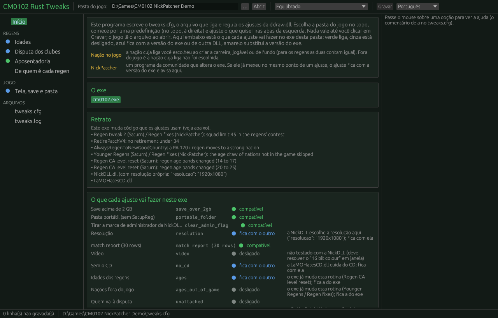
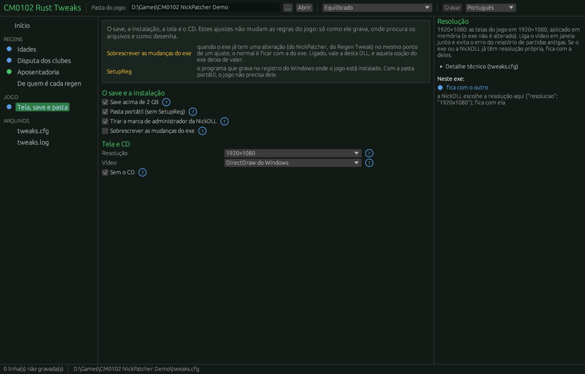
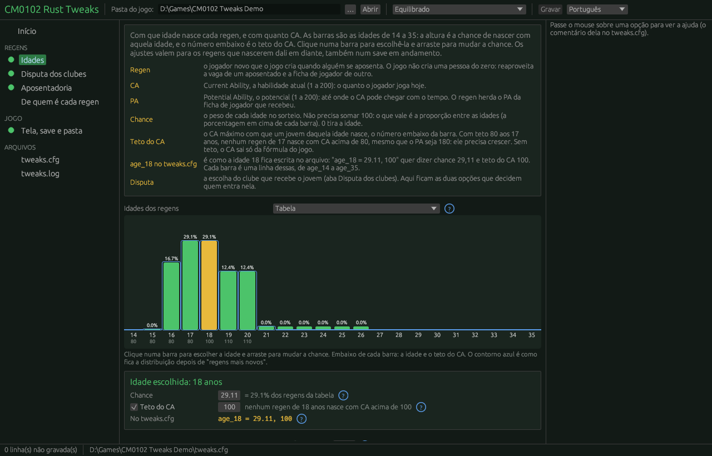
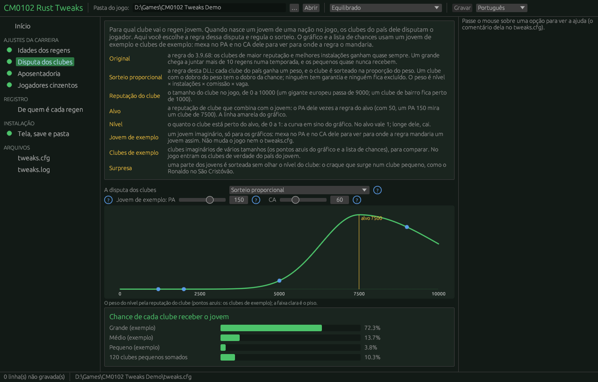
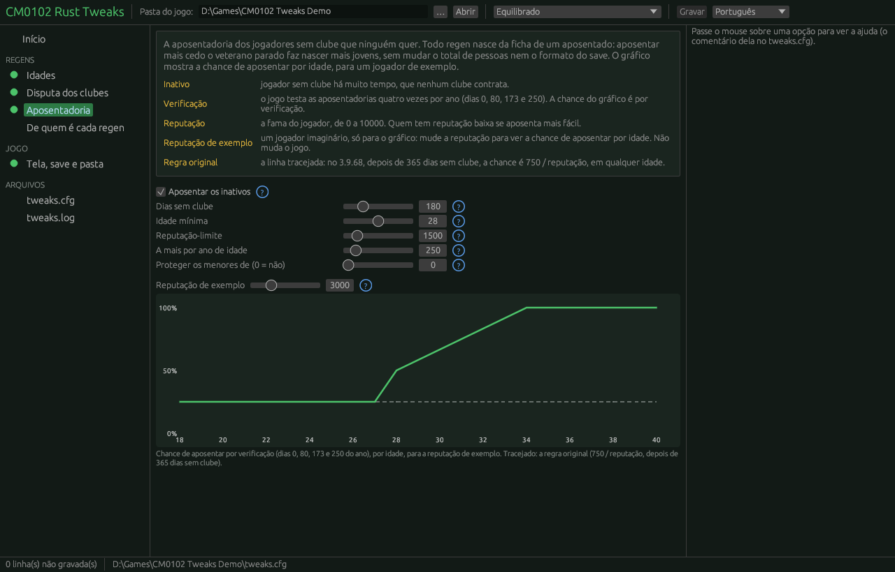
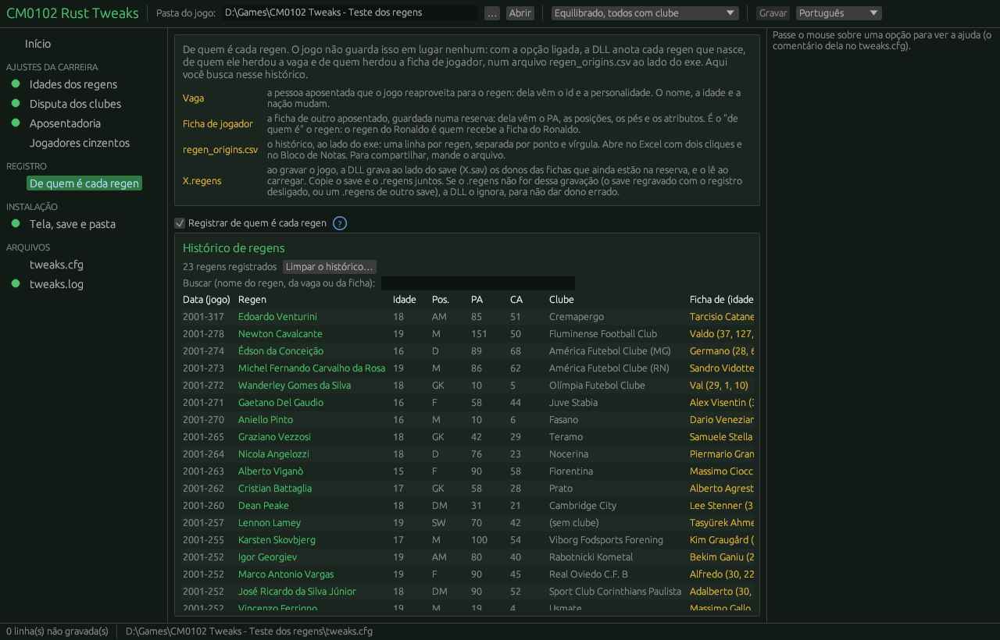
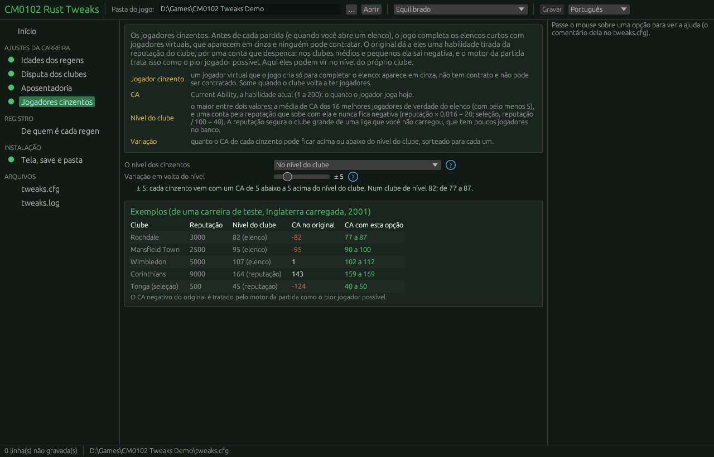

# CM0102-Rust-Tweaks

*English version: [README.md](README.md)*

Ajustes para o **Championship Manager 01/02 (3.9.68)** numa `ddraw.dll`, sem alterar o exe. Feitos com IA, a partir da reescrita do jogo em Rust (o projeto CM0102). Roda com o exe original ou com os do NickPatcher; cada ajuste confere o código do exe antes de ligar.

Cada ajuste tem a sua chave no `tweaks.cfg`, ao lado do exe. **Todos começam desligados:** sem o `.cfg`, ou sem a linha, a DLL não muda nada no jogo. Um configurador (o seletor de opções) vai ler e gravar esse mesmo arquivo.

| Chave | O que faz |
|---|---|
| `save_over_2gb = 1` | O **save acima de 2 GB** (até 4 GB), o mesmo do save2gb: as três rotinas do contêiner (`zopen` 0x9326e0, `zseek` 0x933080, `ztell` 0x933170) vão para as de `src/conteiner.rs` |
| `portable_folder = 1` | **Sem SetupReg**: o `Location` do registro (a pasta para onde o jogo vai ao abrir) é a pasta do próprio exe, pelas importações `RegOpenKeyExA`/`RegQueryValueExA` do exe (`src/pasta.rs`); nada é gravado no registro |
| `multiple_instances = 1` | **Vários jogos abertos, um por pasta**: a trava de jogo único (o mutex "Championship Manager 2001/02 Process", 0x9f183c) ganha no lugar de "Process" 7 dígitos tirados da pasta do exe; jogos de pastas diferentes (o 3.9.68 e o CLZ, duas carreiras em duas cópias) abrem juntos, e dois da mesma pasta continuam barrados (usariam os mesmos temporários e o mesmo save). Junto com `portable_folder = 1` |
| `clear_admin_flag = 1` | **Sem "executar como administrador"**: tira o `RUNASADMIN` que a NickDLL grava para o exe em `HKCU\...\AppCompatFlags\Layers` (só essa palavra, só deste exe; o `WIN95` fica, porque sem ele o CLZ 2026 V6.1 cai ao criar a carreira), da execução seguinte em diante |
| `video = window` | A **camada de vídeo do projeto CM0102** (cópia de `video.rs`, `apresentacao.rs`, `reducao.rs` e `win.rs` de lá): o jogo desenha num DirectDraw nosso e o quadro vai para uma janela comum. Print Screen funciona, a janela muda de tamanho com escala nítida e o modo de vídeo do Windows nunca muda (`ChangeDisplaySettingsA` vira nada). Vale em 800×600 |
| `resolution = 1080` | A **resolução 1920×1080** do projeto CM0102, em memória (`src/trocas.rs`, gerado por `tools/gerar_trocas.py` da diferença entre o exe portátil e o de 1080 de lá), com `video = window` e a trava das 30 linhas do `Area::init` (0x402ac0; sem ela, o relatório de uma partida antiga dá a caixa "Area.cpp 507"). Faz o possível: troca os trechos como no 3.9.68, mantém os que o exe já tem e só recusa se algum tiver outro patch; com a NickDLL do CLZ 6.1 cuidando da resolução, fica com ela. A trava das 30 linhas entra com qualquer resolução alta. Ver [docs/COMPATIBILIDADE.md](docs/COMPATIBILIDADE.md) |
| `no_cd = 1` | **Sem o CD**: as 33 checagens do CD contam como achadas (como no exe portátil do projeto CM0102). Checagem por checagem: as que o exe já tem ficam; com a `LaMOHatesCD.dll` ao lado do exe, fica com ela |
| `regen_origins = 1` | **De quem é cada regen**: o `regen_origins.csv`, ao lado do exe, ganha uma linha por regen que nasce, com o nome, a idade, a posição, o PA, o CA e o clube que ganhou a disputa (ou "sem clube"), e de quem ele herdou a vaga (o id e a personalidade) e a ficha de jogador (o PA, as posições e os atributos), com o nome, a idade, o CA e o PA do dono no momento da aposentadoria. Cada linha leva a data do jogo, a data do computador e a carreira (o save). O jogo não guarda essa ligação; o configurador busca por nome ("o regen do Ronaldo") e limpa o histórico. Ao gravar, um `X.regens` ao lado do save guarda os donos das fichas que ainda estão na reserva, e a carreira carregada continua sabendo de quem são; o CSV abre no Excel (`src/origem.rs`, conferido contra o save por `tools/conferir_origens.py`) |
| `regen_names = own` | **Nomes dos regens do próprio país**: a nação usa os próprios nomes do banco a partir de `regen_names_min` (padrão 20), em vez de só acima de 100; com menos, segue o empréstimo do original (outro país da mesma língua ou o mundo inteiro), sem o defeito do grupo de língua 0 (primeiro nome tirado da tabela dos sobrenomes). No update de outubro de 2026, 100 das 231 nações pegam emprestado; com 20, ficam 15. Desvio nas entradas de `database_pick_first_name_for_nation` 0x539c60 e `..._second_name_...` 0x53a1b0 (`src/nomes.rs`) |
| `grey_players = squad` | **Jogadores cinzentos no nível do clube**: os jogadores virtuais que o jogo põe para completar um elenco curto (`VIRTUAL_STAFF`, em cinza, ninguém contrata) ganham o nível do clube ± a metade de `grey_players_spread` (padrão 10, ou seja ± 5). O nível é o maior entre a média de CA dos 16 melhores reais do elenco e uma conta pela reputação que nunca fica negativa. No original, o CA vem da reputação por uma conta que despenca abaixo de 5000 e sai negativo nos clubes médios e pequenos (63% dos cinzentos numa carreira de teste). Um desvio em 0x90e6d4 da `create_virtual_player` 0x90e0a0 (`src/cinzentos.rs`) |
| `ages = custom` | As **idades dos regens** por uma tabela (§ As idades) |
| `retire_idle_players = 1` | **Aposentar os inativos**: o jogador sem clube que ninguém quer se aposenta antes, e a ficha dele vira um regen (§ Aposentar os inativos) |
| `rule = new` | A **disputa dos clubes** pelo jovem regen (`PLAYER_REGEN::pick_best_club_for_player`, 0x7ad0e0) vira um sorteio proporcional (§ A regra nova). A regra original está em [docs/DISTRIBUICAO_DOS_REGENS.md](docs/DISTRIBUICAO_DOS_REGENS.md) |

Quando este repositório for aberto, ele substitui o `CM0102-Rust/cm0102-save2gb`, que passa a apontar para cá: as evoluções ficam todas aqui. Por isso o save está nesta DLL; com uma DLL só, ninguém precisa encadear duas `ddraw.dll`.

O plano está no [ROADMAP.pt.md](ROADMAP.pt.md).

**Estado: trabalho em andamento.** A versão 1.1 é um pré-lançamento ([Releases](https://github.com/CM0102-Rust/CM0102-Rust-Tweaks/releases): a DLL, o configurador, o `tweaks.cfg` e os guias, e o código-fonte): melhorias vão surgir, e ela precisa de testes de quem joga. **Sempre faça backup dos seus saves** antes de experimentar, e mande o `tweaks.log` se algo der errado. Rodou em carreiras automáticas de até dez temporadas no 3.9.68 e cinco no CLZ, sem queda; os números estão em [docs/TESTES.md](docs/TESTES.md). O configurador está descrito em [docs/CONFIGURADOR.md](docs/CONFIGURADOR.md).

**Instalar:** copie `ddraw.dll`, `tweaks.cfg` e `tweaks-config.exe` para a pasta do `cm0102.exe` e abra o configurador. **Tirar:** apague a `ddraw.dll`.

### Telas

| | |
|---|---|
|  |  |
|  |  |
|  |  |
|  | |

## Arquivos

| Arquivo | O quê |
|---|---|
| `src/lib.rs` | A DLL: repassa o `DirectDrawCreate` (a `ddraw_chain.dll` ou a do Windows; com `video = window`, a camada de vídeo própria), lê `tweaks.cfg`, confere as assinaturas e liga cada ajuste |
| `src/conteiner.rs` | O contêiner do save acima de 2 GB (cópia do `rust/src/conteiner.rs` do projeto CM0102; estável desde o save2gb) |
| `src/partes.rs` | As partes, as assinaturas e os casos conhecidos (usados também pelo configurador) |
| `src/pasta.rs` | `portable_folder` e `clear_admin_flag` |
| `src/cinzentos.rs` | `grey_players`: o CA dos jogadores cinzentos pelo nível do clube |
| `src/nomes.rs` | `regen_names`: os nomes das pessoas novas do próprio país |
| `src/video.rs`, `src/apresentacao.rs`, `src/reducao.rs`, `src/win.rs` | A camada de vídeo de `video = window` (cópias dos arquivos do projeto CM0102: mudar lá e copiar para cá) |
| `src/trocas.rs` | As trocas de `no_cd` e `resolution` (gerado por `tools/gerar_trocas.py`) |
| `configurador/` | O configurador, `tweaks-config.exe` (Rust + egui, um exe só): edita o `tweaks.cfg` com barras, gráficos e o estado de cada ajuste no exe (`cd configurador && cargo build --release`) |
| `docs/CONFIGURADOR.md`, `docs/configurador_maquete.html` | O projeto do configurador e a maquete interativa (abre no navegador) |
| `docs/GUIA_DAS_CHAVES.md` | **O guia das chaves para quem joga:** cada opção, o que faz, quando usar e o que acontece no jogo (gerado pelo configurador, `tweaks-config.exe --guia pt`) |
| `docs/COMPATIBILIDADE.md` | O que cada ajuste faz com o Regen Tweak, o NickPatcher, a NickDLL e a LaMOHatesCD (✅ ⚠️ 🔁 ❓) e o que a NickDLL do CLZ 6.1 muda |
| `docs/NICKPATCHER.md` | **Para quem usa o NickPatcher:** cada opção dele que mexe no mesmo lugar de um ajuste, o que convive e o que cada escolha causa |
| `docs/TESTES.md` | Os testes no jogo e os resultados de cada execução (estabilidade, save, retrato, regens) |
| `tweaks.cfg` | As opções, em inglês e comentadas (é o arquivo da comunidade); vai ao lado do exe |
| `tools/calibrar.py` | Simulador fora do jogo: os clubes reais de um país, lidos de um save, disputam várias temporadas de jovens pela regra original e pela nova (com a tabela de idades do `.cfg`) |
| `tools/simula_nota.py` | O exemplo de clubes inventados do documento (§7) |
| `tools/regens_por_clube.py` | Os regens por clube num save, por faixa de reputação e de Training |
| `tools/sav.py` | Leitura dos itens de um `.sav` |
| `tools/gerar_trocas.py` | Gera `src/trocas.rs` da diferença entre o `cm0102.exe`, o portátil e o de 1080 do projeto CM0102 |
| `tools/temporadas.py` | A tabela por temporada de uma carreira longa (as linhas `season` e `regen` do log) |
| `tools/gerar_referencia.py` | Gera `src/referencia.rs` (o hash de cada função e bloco do 3.9.68) para o retrato da DLL |
| `tools/ler_retrato.py` | Dá nome às linhas do retrato no `tweaks.log` |
| `tools/retrato_exe.py` | O retrato de um exe contra o 3.9.68 original: o que mudou, função por função (`tools/mapa_funcoes.csv` e os nomes do mapa da comunidade), as seções novas e os desvios para elas, e o nome de cada mudança pelo catálogo do NickPatcher (`MiscPatches.zip`); o que não está no catálogo aparece como mudança sem nome. `python tools/retrato_exe.py original.exe outro.exe --catalogo MiscPatches.zip --nomes cm0102-function-map/map --saida retrato.md` |

Compilar: `cargo build --release` (sai em `target/i686-pc-windows-msvc/release/ddraw.dll`).

Cada ajuste confere duas assinaturas (FNV-1a) antes de ligar:
- **as bordas**, o que o desvio usa (a entrada, a volta, as rotinas chamadas). Se não batem, o ajuste nunca liga;
- **o corpo**, a rotina original que o ajuste troca. Se só ele difere, o exe já tem outra modificação ali e, **como no resto do projeto, fica a rotina do exe**, com aviso no `tweaks.log`. `override_exe_changes = 1` manda sobrescrever.

Nos exes que temos [observado]:

| Exe | Save | Idade | Idade (fora do jogo) | Inativos | Disputa |
|---|---|---|---|---|---|
| `cm0102.exe`, `cm0102-1080.exe`, portátil | liga | liga | liga | liga | liga |
| os três do CLZ | liga | do exe | do exe | liga | do exe (Regen Tweak) |
| `cm0102_GDI.exe` | nunca | nunca | nunca | nunca | nunca |

"Do exe" vira "liga" com `override_exe_changes = 1`. O log nomeia o Regen Tweak de xeno/Saturn quando o acha.

## As idades

A idade do jovem é sorteada num bloco da `regenerate_as_youth_player` (0x7ac597..0x7ac6f6), que também limita o CA pela idade. Com `ages = custom`, a DLL troca esse bloco por um pequeno trecho de máquina que chama `sortear_idade`: a idade sai da tabela `age_NN = chance, teto do CA` do `.cfg` (14 a 35 anos), e o teto do CA dessa idade é aplicado, menos em `ca_cap_skip`% das vezes. A idade segue para o resto da rotina como na original (o ano de nascimento, os ajustes de atributos pela idade). E `contest_max_age` (padrão 18) troca o corte "menos de 19 anos entra na disputa" (o byte de 0x7ace69).

- **Regens mais novos, a ideia de petermf23** (item 14 do mod dele das divisões polonesas para o 3.9.60): o jovem sorteado com `younger_from_age` (22) anos ou mais fica `younger_by` (6) anos mais novo (22 → 16, 26 → 20), para ter um período de desenvolvimento. A regra vale depois do sorteio, na tabela e nas nações fora do jogo. Nas jogáveis, 22 anos ou mais são raríssimos (uns 0,2%); nas nações fora do jogo, a original sorteia quase sempre 23 a 27, e é ali que a regra pesa (e a idade menor leva também à fórmula do CA dos mais novos). Lá, com `ages_out_of_game = original`, a DLL reproduz o sorteio da original e aplica a regra. Ligada no `.cfg` distribuído; `younger_by = 0` desliga.
- **Quem vai à disputa** (`unattached`): na original, o jovem de nação no jogo só vai à disputa com menos de 19 anos (`contest_max_age` + 1), e aí 3 vezes em 4; os outros começam sem clube mesmo com vaga nos clubes do país (uns 44%). Com `unattached = only_if_no_room` (sugestão do Lucas, 01/11/2026), a DLL tira o corte da idade e o sorteio de 1 em 4 (0x7ace6a e 0x7ace89, por NOP): todo jovem de nação no jogo vai à disputa, e só fica sem clube quando nenhum clube do país é elegível (elenco cheio ou, com `rule = new`, o teto da temporada). As nações fora do jogo seguem o caminho original. Padrão: `original`.
- **"Nação no jogo"** é a de liga escolhida ao criar a carreira, jogável ou de fundo: para os regens, as duas contam igual (o byte `NationLeagueSelected`, +0x11c da nação, é 2 na jogável e 1 na de fundo, gravado pela 0x827110; o código dos regens só testa se não é 0, em 0x7ace81). "Fora do jogo" é a nação de liga não escolhida.
- A tabela padrão do `.cfg` é a distribuição original: 16 a 20 anos quase sempre (17 e 18 com 29% cada), 15 e 21 a 26 raríssimos.
- Diferença assumida: o teto do CA vira um valor por idade. Na original, o de 17 e o de 18 dependem da faixa sorteada (80 ou 90, 100 ou 110).
- As nações fora do jogo com menos de 350 pessoas cadastradas (+0x88) têm um sorteio próprio na original: quase sempre 23 a 27 anos, às vezes 17 a 23, e ali a idade escolhe a fórmula do CA (mais novo, CA menor), sem teto. Com `ages_out_of_game = table` elas também usam a tabela (0x7abeb1..0x7abeea); a fórmula do CA pela idade continua a da original, e os tetos da tabela não valem ali. O padrão é `original`.
- **Os exes do CLZ já mexem na idade** [observado nos bytes]: a faixa raríssima de 15 a 18 vira 14 a 17 (0x7ac5b1), a rara de 21 a 26 vira 20 a 25 (0x7ac699), e as nações fora do jogo passam a usar o sorteio das jogáveis (`jmp` em 0x7abeab). Também trazem o Regen Tweak completo (0x7ad1bf `0x2d` e 0x7a6f48 `jl`) e outra troca de nacionalidade dos jovens (0x7abcd7..0x7abd1c). Por padrão a DLL deixa essas rotinas com o exe.

## Aposentar os inativos

Cada regen nasce da ficha de um jogador que se aposentou. Então, aposentar mais cedo quem ninguém quer dá mais regens por ano. A população total não muda, e o formato do save também não.

**Como o jogo original aposenta** (nos dias 0, 80, 173 e 250 do ano, `find_new_retirements` 0x7a5790) [observado no código]:

1. **A regra da idade** (`player_regen_check_retirement` 0x7a7310) só vale para quem passou do limite de idade da posição, tirado da ficha:

   | Posição | Limite |
   |---|---|
   | goleiro | 34 |
   | atacante, ou meia ofensivo | 30 |
   | os outros | 31 |

   Acima do limite, aposenta, entre outros casos:
   - acima de 45 anos;
   - acima de 34 anos e sem clube há mais de 65 dias: na prática, automático;
   - pela nota (1 − 0,075 × anos acima do limite) × reputação, com sorteios.
2. **A regra do desempregado** (`player_regen_check_unemployed_retirement` 0x7a8050), quando a primeira não aposentou. **Não olha a idade**: sem clube há mais de 365 dias, aposenta com sorteio(reputação atual) < 750. Até um regen de 22 anos que ninguém contratou pode sair por ela. Quem está na lista de observados de algum clube não se aposenta.

**Há fila:** quem se aposenta entra numa lista com uma data (hoje, na regra do desempregado; em geral o fim da temporada, na da idade). Na data, a ficha vai para a reserva, a vaga entra na fila dos regens (hoje, ou em 1 a 65 dias a partir dos 30 anos), e o regen nasce quando há ficha. Então uma aposentadoria a mais vira um regen a mais, com algumas semanas de atraso.

**O que `retire_idle_players = 1` muda** (a 0x7a8050 trocada; a regra da idade fica como está), só para jogadores:

| Chave | Padrão | O quê |
|---|---|---|
| `idle_days` | 180 | dias sem clube (a original: 365) |
| `idle_min_age` | 28 | a partir dessa idade vale a regra nova; abaixo, a original |
| `idle_rep` | 1500 | o limiar do sorteio aos `idle_min_age` anos (a original: 750) |
| `idle_rep_per_year` | 250 | quanto o limiar sobe por ano de idade |
| `protect_young_unemployed` | 0 | abaixo dessa idade, a regra do desempregado não aposenta; 0 = sem proteção (o padrão: numa carreira de teste, proteger os menores de 23 cortou a maior parte da reciclagem em regens, e a original já dá 365 dias ao jovem sem clube) |

Aposenta quando sorteio(reputação atual) < `idle_rep` + `idle_rep_per_year` × (idade − `idle_min_age`). Exemplo, com reputação 3000:
- aos 28 anos, 50% por busca;
- aos 31, 75%;
- aos 34, 100%.

Um bom desempregado de 28 anos (reputação 6000) fica com 25% por busca e tem tempo de achar clube.

**Nos exes do CLZ, a regra quase não age:** o NickPatcher pula, na busca de aposentadorias (0x7a5790), quem tem menos de 34 anos (um `jmp` em 0x7a5806 para a seção `.nick`), e de 34 em diante a regra da idade do jogo já aposenta quem está sem clube há mais de 65 dias. Numa carreira de duas temporadas no CLZ, ela não aposentou ninguém [observado]. O `tweaks.log` avisa disso na partida. Os técnicos sem clube seguem a regra original, e quem está numa lista de observados continua sem se aposentar.

## A regra nova

Os clubes elegíveis são os mesmos da original:
- o jovem não é estrangeiro no clube;
- não é time B;
- não é vetado pela regra basca;
- o clube pode chegar ao jogador;
- elenco abaixo do teto.

Cada clube recebe um **peso**, e o clube é sorteado **na proporção do peso**, pelo gerador do próprio jogo. Peso nenhum: o jovem fica sem clube, como na original.

**A sequência aleatória muda:** a regra nova gasta 2 sorteios do gerador por jovem; a original gasta 1 por clube elegível (e às vezes mais, nos bônus da nota). A tabela de idades também gasta outros sorteios. Para um mod é o esperado, mas uma carreira com a mesma semente (`-seed`) não sai igual à do jogo sem a DLL.

    peso = (nível × instalações × comissão × vaga) ^ temperatura

| Fator | Conta | Ajustes |
|---|---|---|
| Nível | curva em sino da reputação do clube em torno do alvo = target_k × PA (ou a mistura com o CA); **assimétrica**: acima do alvo a largura é `sigma`, abaixo é `sigma_below`, mais estreita, porque as centenas de clubes pequenos de um país, somadas, levariam os jovens bons | `target_k`, `target_ca`, `sigma`, `sigma_below`, `level_floor` |
| Surpresa | em `surprise`% dos jovens o nível não conta, e só entram os clubes de competição que roda no jogo: o jovem bom que nasce no clube pequeno; o mercado o leva depois | `surprise` |
| Instalações | facilities_base + facilities_k × Training | `facilities_base`, `facilities_k` |
| Comissão | de staff_min a staff_max pelo melhor "Working with Youngsters" entre o técnico e os 5 treinadores. Vale para a IA e para o humano igual | `staff_min`, `staff_max` |
| Vaga | ((squad_limit − elenco) / squad_limit) ^ squad_exp; com o elenco no teto, peso 0 | `squad_limit`, `squad_exp` |
| Teto por clube | peso 0 se o clube já recebeu `season_cap` regens nos últimos 365 dias: a DLL guarda cada jovem que entregou, com a data, e conta mesmo os que o clube já emprestou, vendeu ou mandou ao time B; depois de carregar um save (a lista não vai para o save), vale a contagem pelo próprio save: o bit do regen e a data de entrada no clube (numa base com a linha `ARSE`, que marca todo mundo, só a lista) | `season_cap` |
| Fora das competições | o peso do clube cuja divisão não roda no jogo (nem como liga de fundo) é multiplicado por `outside_competitions` (1 = igual aos outros, o padrão; 0 = nunca). Com poucas ligas carregadas, a maioria dos clubes de um país fica fora, e 1 pode servir melhor; com muitas, um valor baixo mantém cheios os elencos das ligas jogadas (TESTES §4.5). Na surpresa eles já ficam de fora | `outside_competitions` |
| Temperatura | expoente: 1 proporcional, maior mais previsível, menor mais aleatório | `temperature` |

Com `log = 1`, o `tweaks.log` registra o que acontece, uma linha por evento: `tick` (a data do jogo a cada mês, com o resumo, para saber se a carreira anda mesmo quando nenhum ajuste escreve), `regen` (cada jovem da disputa, pela regra nova, pela original ou pela do exe), `birth` (cada nascimento pela tabela de idades), `idle` (cada aposentadoria pelos inativos), `season` (em julho de cada ano, a população: elencos, sem clube, regens, o clube com mais regens, os de PA ≥ 150), `hang` e `msgbox`, `check` (os desvios conferidos depois das DLLs do exe) e `crash` (a primeira violação de acesso, com endereço e registradores). O `tools/comparar_logs.py` compara dois logs; o `tools/temporadas.py` monta a tabela por temporada de uma carreira longa.

**O retrato do exe**, sempre no começo do log: `exe` diz se o exe é o 3.9.68 sem mudanças ou quantas funções e blocos de dados mudaram, o ponto de entrada, as seções novas e os casos já identificados (Regen Tweak, opções do NickPatcher, faixas de idade do CLZ); `runtime` diz se outra DLL mudou o código do exe depois de carregar e avisa quando a mudança cai num trecho que um ajuste conferiu na abertura, com o destino do desvio (módulo e deslocamento). Os desvios já lidos viram nota: no CLZ, a NickDLL troca a `club_get_linked_b_team` (0x540a50) pela dela, com os pares de times B do banco carregado, e a disputa passa a usá-la, como a rotina do exe usaria; a `LaMOHatesCD.dll` filtra a caixa de mensagem (0x5e8290), e os erros do contêiner do save continuam aparecendo. Com `log = 1`, as linhas `exe-fn`, `exe-data` e `runtime-fn` listam cada função e bloco; `python tools/ler_retrato.py tweaks.log --exe o_exe.exe --catalogo MiscPatches.zip --nomes cm0102-function-map/map` põe o nome da função e dos patches do catálogo do NickPatcher. Assim, um `tweaks.log` enviado por alguém já diz com que exe ele joga.

**As caixas de mensagem do jogo** (`log = 1`): toda caixa vira uma linha `msgbox` com a data do jogo, o título e o texto, antes de aparecer, inclusive os erros com o arquivo de código e a linha (`Database..cpp 7784` na troca de idioma do banco de outubro de 2026, `friendly..cpp 4695` num save acima de 2 GB carregado sem `save_over_2gb`). A caixa é desenhada pelo jogo, e um teste com o jogo oculto não a via. O desvio da `gui_show_message_box` (0x5e8290) é posto depois das DLLs do exe: com a entrada original, os 9 bytes vão para um trampolim; com o salto de outra DLL ali (a LaMOHatesCD do CLZ), encadeia nele; com outra coisa, não mexe e diz isso no log.

## De quem é cada regen (`regen_origins`): os arquivos, as provas e quando falta um arquivo

**Os arquivos.** Com `regen_origins = 1`, a DLL escreve dois tipos de arquivo:
- `regen_origins.csv`, ao lado do exe: uma linha por regen que nasce, com a vaga e a ficha de jogador que ele herdou (nome, idade, CA e PA de cada dono na aposentadoria), o clube, as datas do jogo e do computador e a carreira (o nome do save). Abre no Excel com dois cliques (UTF-8, ponto e vírgula; num Excel em inglês, Dados > De Texto/CSV). Se ele estiver aberto no Excel enquanto o jogo roda, as linhas esperam na memória e entram depois; se o jogo fechar antes, vão para `regen_origins_pending.txt` e entram na próxima abertura.
- `X.regens`, ao lado de cada save `X.sav`, gravado a cada gravação do jogo: os donos das fichas que ainda estão na reserva (as que vão virar regen nas próximas semanas). Na carga, a DLL o lê e a carreira continua sabendo de quem é cada ficha. O save não muda.

**As provas** (03/11/2026, detalhe em [docs/TESTES.md](docs/TESTES.md) §4.6). Um verificador, `tools/conferir_origens.py`, confere cada linha do CSV contra o save gravado depois: o regen tem de existir no save como regen, com o mesmo nome, a mesma nação e o mesmo PA, e o PA tem de ser o da ficha do dono registrado. Uma mutação proposital (um nome e um PA trocados) deu 3 erros: o verificador acusa.

| Prova | Regens | Donos desconhecidos | Erros |
|---|---|---|---|
| Base de fábrica, carreira nova até 01/12/2001, gravada | 23 | 0 | 0 |
| Carregada e jogada até 30/05/2002 | 550 | 0 | 0 |
| Carregada e jogada até 29/07/2002 (511 fichas na reserva na gravação) | 265 | 0 | 0 |
| Carregada **sem** o `.regens` | 450 | 168 | 0 |
| Carregada **com** o `.regens` | 450 | 0 | 0 |
| CLZ 6.1 (NickPatcher, a NickDLL mais nova, LaMOHatesCD): um save sem a Bélgica, 60 dias de jogo | 745 | 0 | 0 |
| CLZ 6.1: carregado com o `.regens` dele | 318 fichas na reserva, 318 donos lidos do arquivo | 0 | — |
| CLZ 6.1: carregado com o `.regens` de outro save, de propósito | o arquivo recusado | — | 0 |

**Quando falta o `.regens`.** Ele falta se:
- só o `.sav` foi copiado (mandado para alguém, backup, outro PC);
- o save foi renomeado no Explorer (`X.sav` vira `Y.sav`, e o arquivo continua `X.regens`);
- o save foi gravado com o registro desligado, antes de instalar a DLL, ou com outra `ddraw.dll`.

Aí os primeiros regens depois da carga podem sair com o dono **desconhecido**, nunca errado: a linha diz "unknown: the save was loaded without its .regens file". A DLL ainda recupera parte deles pelo próprio jogo (o dono que a fila gravou, quando ele ainda aponta para a ficha: 326 de 511 na prova). Quando a reserva se renova (semanas de jogo), todos voltam a ter dono. O `tweaks.log` conta, na carga, quantos donos vieram do arquivo, quantos do jogo e quantos ficaram desconhecidos. **Copie o save e o `.regens` juntos.**

**Quando o `.regens` é velho.** Se o save foi regravado com o registro desligado (ou por outra DLL), ou se um `.regens` de outro save foi posto ao lado dele, o arquivo não é daquela gravação. Como o jogo reaproveita o número da ficha quando um regen se aposenta, usá-lo daria donos errados. Por isso o `.regens` leva a lista das fichas da reserva na hora da gravação, e a DLL só o aceita se a reserva do save carregado for idêntica; senão, ignora o arquivo e avisa no log (e os donos ficam como no caso de faltar o arquivo).

**Quando a base tem a linha `ARSE` no `player_setup.cfg`.** O jogo marca o regen jogador com um bit no registro da pessoa (o bit 0x40 do byte +0xb, no general.dat do save), e normalmente só a rotina que cria o regen liga esse bit. A linha `ARSE` do `player_setup.cfg` liga esse bit em **todas** as pessoas, na criação da carreira, e ele fica gravado no save para sempre: todo mundo passa a parecer regen. Nem o `player_setup.cfg` de fábrica nem o do CLZ têm essa linha; só uma base modificada. Nessa carreira:
- o `regen_origins.csv` continua certo: ele anota cada regen na hora em que o jogo o cria, sem olhar o bit;
- o `tools/conferir_origens.py` não acusa um regen que falte no save (para ele, todos são regens);
- a contagem de regens da linha `season` do `tweaks.log` conta todo mundo;
- o `season_cap` (o teto de jovens por clube por ano) conta só os jovens que a própria DLL entregou: depois de carregar um save, ele não vê os do ano anterior à carga (a lista da DLL não vai para o save). Sem isso, contaria como regen todo jogador que entrou no clube no ano.

A DLL reconhece essa carreira sozinha, sem contar quantos têm o bit nem ler o `.cfg` de agora: os técnicos humanos (as últimas vagas da tabela de pessoas) nunca viram regen, então um técnico humano com o bit só pode ser obra do `ARSE`. Vale para a carreira nova e para o save carregado. O `tweaks.log` marca `arse (player_setup.cfg)` nas linhas `tick` e `season`.

Os editores que filtram "só regens" pelo mesmo bit também ficam inúteis nessa carreira.

**Quando o registro não liga.** Se algum ponto do exe que ele usa difere do 3.9.68 (outro patch ali), o registro não liga, e o `tweaks.log` diz onde: um registro pela metade daria donos errados.

## A calibração (simulador, `TesteTelas.sav`, 200 temporadas)

A configuração distribuída no `tweaks.cfg` (fechada com o Lucas em 01/11/2026):

| Chave | Valor |
|---|---|
| `target_k` | 50 (o alvo de um PA 150 é a reputação 7500) |
| `sigma`, `sigma_below` | 2500 acima do alvo, 1200 abaixo |
| `facilities_base`, `facilities_k` | 0,4 e 0,06 (Training 20 vale 3,5 vezes o Training 1) |
| `staff_min`, `staff_max` | 0,8 e 1,2 |
| `squad_limit`, `season_cap` | 48 e 2 por clube a cada 365 dias |
| `surprise` | 15% |
| `temperature` | 1 |

O simulador sorteia o PA entre os jogadores de 31 anos ou mais de cada país e usa os clubes reais do save. O elenco volta ao do save a cada temporada [simplificação: na carreira real os elencos variam, e os grandes que no save estão com 46 a 48 jogadores ficam quase sem vaga aqui]. Na tabela, jovens por clube por temporada; entre parênteses, os de PA ≥ 140.

| Reputação | Inglaterra: original | Inglaterra: nova | Brasil: original | Brasil: nova | Itália: original | Itália: nova |
|---|---|---|---|---|---|---|
| abaixo de 2000 | 0,01 (0,000) | 0,03 (0,001) | 0,01 (0,000) | 0,02 (0,001) | 0,07 (0,000) | 0,14 (0,007) |
| 2000–3999 | 0,32 (0,001) | 0,18 (0,002) | 0,18 (0,002) | 0,18 (0,003) | 0,53 (0,015) | 0,43 (0,006) |
| 4000–5999 | 0,22 (0,025) | 0,39 (0,017) | 0,33 (0,032) | 0,53 (0,022) | 0,36 (0,069) | 0,35 (0,018) |
| 6000–7999 | 0,61 (0,082) | 0,39 (0,072) | 0,87 (0,118) | 0,60 (0,106) | 1,39 (0,24) | 0,51 (0,16) |
| 8000 ou mais | 1,58 (0,10) | 0,26 (0,10) | 0,47 (0,034) | 0,12 (0,048) | 1,35 (0,10) | 0,31 (0,16) |

- **Os grandes deixam de recolher os jovens comuns** (Inglaterra 8000+: de 1,58 para 0,26 por temporada), mas **ficam com a parte deles dos craques** (PA ≥ 140: 0,10 nos dois).
- **Os médios bem estruturados passam a ser o destino natural** (Inglaterra 4000–5999: de 0,22 para 0,39; Brasil: de 0,33 para 0,53).
- **A Itália** ainda manda uma parte grande dos jovens aos clubes pequenos. Sem o teto e sem a surpresa o quadro quase não muda: o que segura os grandes italianos é o elenco do save (Milan, Sampdoria, Udinese e Torino com 48, fora da disputa; Inter e Parma com 46). A prova no jogo mede isso com os elencos reais.

Tentativas descartadas [observado no simulador]:
- **Uma largura só, de 2500:** na Itália, quase metade dos jovens de PA ≥ 140 ia para clubes de reputação abaixo de 2000. Daí a largura abaixo do alvo.
- **Piso de nível de 5% e elenco 45:** os grandes zeravam, e uns 30 dos 52 jovens ingleses iam para os 499 clubes amadores.
- **Temperatura 0,7 para mais aleatoriedade:** escorria para os clubes amadores; a surpresa faz isso de um jeito controlado.
- **Temperatura 2:** concentrava demais nos clubes do tamanho certo.

Rodar: `python tools/calibrar.py TesteTelas.sav Inglaterra --humano Fulham --temporadas 200 [--cfg outro.cfg]`.

## Próximos passos

Ver o [ROADMAP.pt.md](ROADMAP.pt.md). O próximo é a prova no jogo (fase 2).

## Licença

MIT ([LICENSE](LICENSE)). O jogo, o executável e o banco de dados não fazem parte deste repositório.
