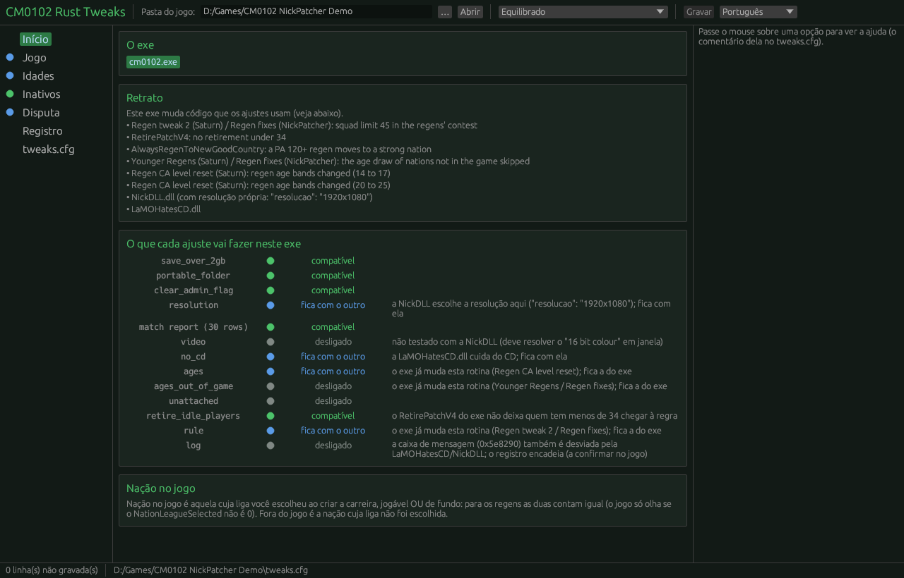
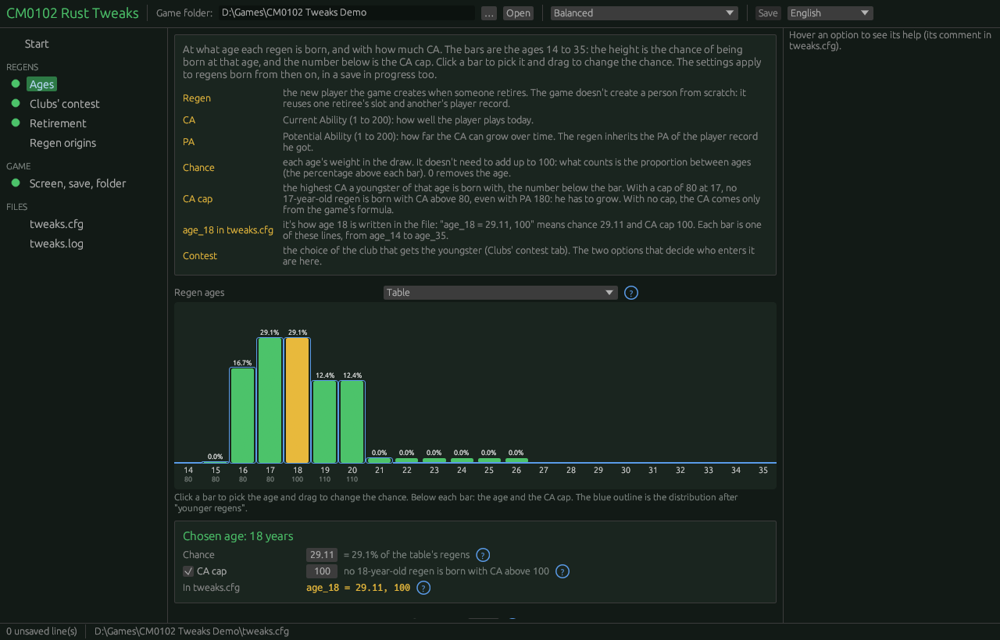
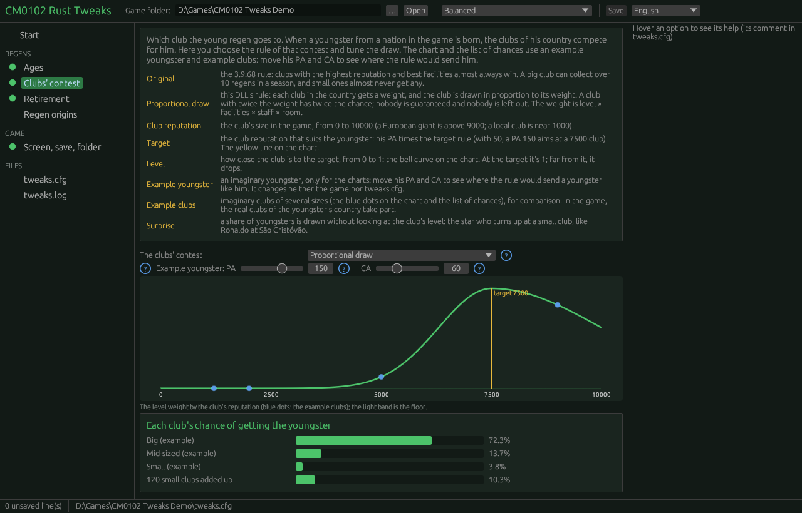
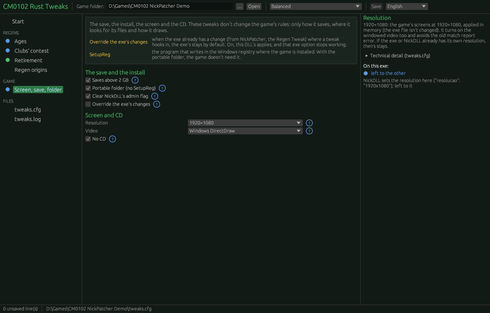
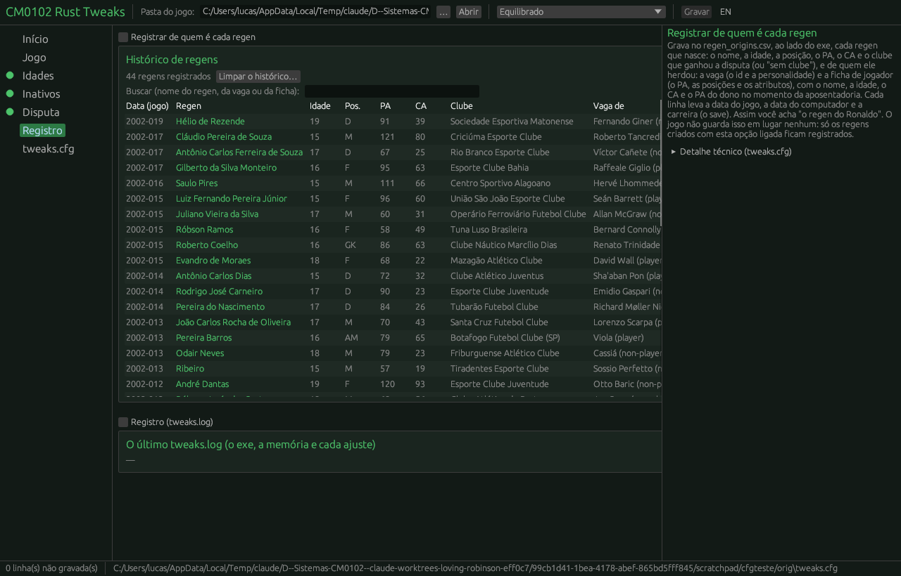

# The configurator: interface design

*Versão em português: [CONFIGURADOR.md](CONFIGURADOR.md)*

The design for Phase 3 of the [ROADMAP](../ROADMAP.md): the program that edits `tweaks.cfg` with sliders, charts and the exe's status. The design, the mock-up and, since 11/02, the program prototype (§10). The interactive mock-up, which opens in a browser, is [configurador_maquete.html](configurador_maquete.html). Written on 02/11/2026.

Sources: `tweaks.cfg`, `src/lib.rs` (`Regras`, `PADRAO`, `ler_regras`, the `Parte` entries and `pode_ligar`), `src/retrato.rs`, `src/pasta.rs`, [TESTES.en.md](TESTES.en.md). The ranges below are the code's; where the code sets no limit, the range is **proposed** (or "to be decided") and marked as such.

## 1. Principles

- **One `.exe`** (`tweaks-config.exe`), separate from the DLL, with no installer and nothing to install first. It opens next to the game exe, or asks for the folder.
- **`tweaks.cfg` is the only source.** The configurator reads the file, shows it and writes it back by replacing only the value of changed lines. Comments, order, blank lines and keys it doesn't know stay as they are (§5).
- **Slider and field move together.** Every numeric option has a slider and a text field, linked: moving one moves the other.
- **Help on the side.** Each option's help is its own comment in the `.cfg`. It shows in the right panel when you hover over or focus the control.
- **See before saving.** Charts that change while you drag: the ages, the level curve, each club's chance and the retirement chance.
- **The exe first.** For the chosen exe, every tweak says what will happen: on, kept by the exe, or won't work (§6).
- **Its own look.** Nothing from the NickPatcher interface (a grey form with tabs of checkboxes). A night-pitch dark background, a green accent, one card per tweak and large charts.

## 2. The window

```
┌──────────────────────────────────────────────────────────────────────────────────────┐
│ CM0102 Rust Tweaks   Exe: [cm0102.exe ▾ CLZ (NickPatcher)]  Preset: [Balanced ▾]  [Save] │
├────────────┬─────────────────────────────────────────────────────┬───────────────────┤
│ Start      │                                                     │ Help              │
│ Game       │   cards of the chosen tab                           │ (the .cfg comment │
│ Ages       │   (switches, slider+field, charts)                  │  of the option    │
│ Idle       │                                                     │  under the mouse) │
│ Contest    │                                                     │                   │
│ Log        │                                                     │ In this exe:      │
│ tweaks.cfg │                                                     │ ● on              │
├────────────┴─────────────────────────────────────────────────────┴───────────────────┤
│ 3 unsaved changes · tweaks.cfg in D:\Games\CM0102 · last tweaks.log read: 02/11 21:40 │
└──────────────────────────────────────────────────────────────────────────────────────┘
```

- **Top bar:** the chosen exe (a list of the `.exe` files in the folder), the preset (§4) and Save. The preset shows "Custom" when the values match none.
- **Left:** the tabs, each with a coloured dot with the worst state among its tweaks that are on, in that exe (§6.1: green ✅, yellow ⚠️, blue 🔁, red ❓, grey off). Above everything, the warning strip when there is a ⚠️ or ❓.
- **Right:** the help and the tweak's status in the exe (§6).
- **Footer:** pending changes, the `.cfg` path, and whether there is a recent `tweaks.log` (§6.3).

## 3. Tabs and controls

Columns: **Control**; **Accepts** (what `ler_regras` accepts, with the code's limits); **Slider** (the slider's range); **No line** (the DLL default, `PADRAO`); **In .cfg** (the value in the distributed `tweaks.cfg`).

Range rule: the **field** accepts the whole valid range. The **slider** covers the useful part and sits at its end when the value goes past it. For keys the code doesn't limit, the valid range is the proposed one (Lucas's decision, §9).

Switches always write `1` or `0`, because the DLL only turns on with an exact `v == "1"` (`log` turns on with any number other than 0). Selectors write the exact word the DLL tests (`custom`, `new`, `table`, `only_if_no_room`); any other word means the original.

### 3.1 Start

No value controls. It shows:
- the **exe snapshot**: name, size, whether it is the untouched 3.9.68 or how many functions and blocks changed, new sections (the CLZ's `.nick`), the known cases by name (the `CONHECIDOS` table in `retrato.rs`);
- the **"what each tweak will do" table** (§6), one row per tweak, with the state, the reason, the patch name and a "go to tab" button;
- the DLLs found next to the exe (`NickDLL.dll`, `LaMOHatesCD.dll`) and, with NickDLL, the `"resolucao"` in `NickDLL_config.json`;
- the preset in use and the differences from it.

### 3.2 Game (save, folder, admin flag, override)

| Key | Control | Accepts | Slider | No line | In .cfg |
|---|---|---|---|---|---|
| `save_over_2gb` | switch | `1` on, anything else off | — | 0 | 0 |
| `portable_folder` | switch | same | — | 0 | 0 |
| `clear_admin_flag` | switch (with a "only useful with NickDLL" note when there is no `NickDLL.dll` in the folder) | same | — | 0 | 0 |
| `override_exe_changes` | switch with confirmation ("replace the exe's changes with this DLL's rules") | same | — | 0 | 0 |
| `video` | selector (original / window) | `window` turns it on, anything else off | — | original | original |
| `resolution` | selector (original / 1920×1080); with 1080, `video` shows on and locked | `1080` turns it on, anything else off | — | original | original |
| `no_cd` | switch | `1` turns it on, anything else off | — | 0 | 0 |

- `resolution = 1080` **turns on and locks `video`**: when the resolution applies in this exe, the video selector shows "window", greyed out, with the note "turned on by the resolution" (the DLL turns the window on by itself; the `.cfg` keeps the `video` the user chose). When the resolution is left to another (NickDLL) or won't work, the video follows its own selector again.
- The resolution card also shows the state of the **30-row limit** for the match report (`Area::init`), which the DLL adds with `resolution`, `video` or NickDLL's resolution, with no key of its own.

### 3.3 Ages

A "**Nation in the game**" card at the top (§7), then:

| Key | Control | Accepts | Slider | No line | In .cfg |
|---|---|---|---|---|---|
| `ages` | two-way selector: "Table" (`custom`) / "Original" (`original`) | `custom` turns on | — | original | custom |
| `age_14` … `age_35` | **draggable bar chart** (the chance) + field for the chosen bar + CA cap field | chance: a number, negative becomes 0, no maximum; cap: integer (the `.cfg` says 1 to 200), no cap = left out | chance 0–40 (proposed) | the original table: 15 = 0.0025; 16 = 16.67; 17 and 18 = 29.11; 19 and 20 = 12.44; 21 to 26 = 0.04; the rest 0 | same |
| `younger_from_age` | slider + field | integer, no limit in the code | 14–35 (proposed) | 22 | 22 |
| `younger_by` | slider + field ("0 = off") | integer ≥ 0 | 0–15 (proposed) | **0** | 6 |
| `ages_out_of_game` | selector: "Original draw" / "The table too" | `table` | — | original | original |
| `ca_cap_skip` | slider + field, in % | number, no limit (it's a %) | 0–100 (proposed: 0–5 on the slider) | 0.5 | 0.5 |
| `contest_max_age` | slider + field; greyed out when `unattached = only_if_no_room` (it doesn't count there) | integer 0–126 | 14–25 (proposed) | 18 | 18 |
| `unattached` | selector: "Original" / "Without a club only if no room" | `only_if_no_room` | — | original | original |

**The age chart** (the centre of the tab):
- 22 bars, ages 14 to 35. The height is the relative chance; the label, the normalised percentage (the chances don't need to add up to 100). Square-root scale, so 0.04 shows next to 29.11.
- Dragging a bar up or down changes the chance. Clicking picks the age: below the chart, slider + field for the chance and a field for the CA cap (empty = no cap).
- Under each bar, the CA cap (80, 100, 110...) on a badge.
- **"After younger regens" overlay:** outlines showing the final distribution when `younger_by > 0` (whoever is drawn at `younger_from_age` or older moves down `younger_by` years). It changes while you drag either slider.
- `ages = original` greys the chart out with the note "the table doesn't apply: the game uses the 3.9.68 ages".

### 3.4 Idle players

| Key | Control | Accepts | Slider | No line | In .cfg |
|---|---|---|---|---|---|
| `retire_idle_players` | switch | `1` on | — | 0 | 1 |
| `idle_days` | slider + field, in days | integer ≥ 0 | 0–730 (proposed) | 180 | 180 |
| `idle_min_age` | slider + field | integer, no limit in the code | 16–40 (proposed) | 28 | 28 |
| `idle_rep` | slider + field | number ≥ 0 | 0–10000 (proposed) | 1500 | 1500 |
| `idle_rep_per_year` | slider + field | number ≥ 0 | 0–2000 (proposed) | 250 | 250 |
| `protect_young_unemployed` | slider + field ("0 = no protection") | integer ≥ 0 | 0–30 (proposed) | 0 | 0 |

**Chart:** the chance of retiring per check (the game checks on days 0, 80, 173 and 250 of the year), by age from 18 to 40, for a sample reputation (its own slider, 500 to 10000, starting at 3000):
- from `idle_min_age` on: `min(1, (idle_rep + idle_rep_per_year × (age − idle_min_age)) / reputation)`, after `idle_days` without a club (solid line);
- under `idle_min_age`: the original rule, `min(1, 750 / reputation)` after 365 days (dashed);
- under `protect_young_unemployed`: zero;
- switched off: only the dashed line, at every age.

With reputation 3000 and the distributed `.cfg`, the chart must give 50% at 28, 75% at 31 and 100% at 34 (the `.cfg`'s own example). A note recalls the original's other rule (past the position's age limit), which doesn't change.

### 3.5 Contest (regens)

| Key | Control | Accepts | Slider | No line | In .cfg |
|---|---|---|---|---|---|
| `rule` | selector: "Proportional draw" (`new`) / "Original" | `new` turns on | — | original | new |
| `target_k` | slider + field | number, no limit | 0–100 (proposed) | 50 | 50 |
| `target_ca` | slider + field ("0 = PA, 1 = CA") | number, no limit (meaning 0–1) | 0–1 | 0 | 0 |
| `sigma` | slider + field | number ≥ 1 | 100–10000 (proposed) | 2500 | 2500 |
| `sigma_below` | slider + field ("0 = same as sigma") | number ≥ 0 | 0–10000 (proposed) | 1200 | 1200 |
| `level_floor` | slider + field | number, no limit (the `.cfg` says 0 to 1) | 0–0.05 on the slider, 0–1 in the field (proposed) | 0.002 | 0.002 |
| `facilities_base` | slider + field | number, no limit | 0–2 (proposed) | 0.4 | 0.4 |
| `facilities_k` | slider + field | number, no limit | 0–0.2 (proposed) | 0.06 | 0.06 |
| `staff_min` | slider + field | number, no limit | 0–2 (proposed) | 0.8 | 0.8 |
| `staff_max` | slider + field (warning if below `staff_min`) | number, no limit | 0–2 (proposed) | 1.2 | 1.2 |
| `squad_limit` | slider + field | 1–50 (the code clamps) | 20–50 | 48 | 48 |
| `squad_exp` | slider + field | number, no limit | 0–3 (proposed) | 0.5 | 0.5 |
| `season_cap` | slider + field ("0 = no cap") | number, no limit | 0–10 (proposed) | 2 | 2 |
| `surprise` | slider + field, in % | 0–100 (the code clamps) | 0–50 | 15 | 15 |
| `temperature` | slider + field | number, no limit | 0.25–3 (proposed) | 1 | 1 |

Three live drawings:
1. **The level curve.** x axis: club reputation, 0 to 10000. y axis: level weight, 0 to 1. A vertical line at the target (`target_k × ((1 − target_ca) × PA + target_ca × CA)`), the asymmetric curve (`sigma_below` on the left, `sigma` on the right) and the floor (`level_floor`) as a light band in the background. The sample clubs show as dots on the curve. The sample youngster has PA and CA on their own sliders (PA 150, CA 60).
2. **Facilities and staff** as one changing line of text: "Training 1 = 0.46 · 10 = 1.00 · 20 = 1.60" and "worst coach 0.80 · best 1.20".
3. **Chances by club.** Horizontal bars with each sample club's chance of getting the youngster, using the same maths as `peso()` in `lib.rs` (level × facilities × staff × room, raised to `temperature`; out if the squad is ≥ `squad_limit` or the club already got `season_cap`). The surprise is mixed in: `(1 − s) × normal + s × surprise`, the surprise without the level and only among clubs in a competition. The original rule (the highest random(score)) is not drawn: it's a different calculation, and the example shows only the new one.

The sample clubs are made up and labelled as such ("example"): a big one, a mid-sized one, a small one and "120 small clubs added up", to show why `sigma_below` and `level_floor` exist (hundreds of small clubs, added up, take the youngsters). Future improvement: load the real clubs from a save, like `tools/calibrar.py` (§9).

`rule = original` greys out the three drawings with the note "the game uses the 3.9.68 contest".

### 3.6 Log

| Key | Control | Accepts | No line | In .cfg |
|---|---|---|---|---|
| `log` | switch | any number ≠ 0 turns on; writes 1 or 0 | 0 | 0 |

The tab shows the help for the log lines (the `.cfg`'s own comment) and, if there is a `tweaks.log` in the folder, the `exe`, `runtime` and per-tweak lines from the last start (§6.3).

### 3.7 tweaks.cfg

The file as it will be, with the changed lines highlighted and, at the top, "N lines changed, M added, none removed". Read-only. Buttons: Save and Undo all (back to what was read from disk).

## 4. Presets

Presets touch the gameplay groups (ages, idle players, contest) and, only "Save only", `save_over_2gb`. They don't touch `portable_folder`, `clear_admin_flag`, `override_exe_changes` and `log`, which depend on the install, not on taste.

| Key | Original | Save only | Balanced | Balanced, everyone gets a club |
|---|---|---|---|---|
| `save_over_2gb` | (unchanged) | 1 | (unchanged) | (unchanged) |
| `ages` | original | original | custom | custom |
| `age_NN` table | (unchanged) | (unchanged) | the original | the original |
| `younger_from_age`, `younger_by` | (unchanged) | (unchanged) | 22, 6 | 22, 6 |
| `ages_out_of_game` | original | original | original | original |
| `ca_cap_skip`, `contest_max_age` | (unchanged) | (unchanged) | 0.5, 18 | 0.5, 18 |
| `unattached` | original | original | original | **only_if_no_room** |
| `retire_idle_players` | 0 | 0 | 1 | 1 |
| idle (days, age, rep, per year, protection) | (unchanged) | (unchanged) | 180, 28, 1500, 250, 0 | same |
| `rule` | original | original | new | new |
| contest (`target_k` … `temperature`) | (unchanged) | (unchanged) | the Phase 1 values (the distributed `.cfg`) | same |

- **Original:** the DLL changes nothing in the game; the numbers stay as they are because they don't apply with the switches off.
- **Save only:** for those coming from `cm0102-save2gb`.
- **Balanced:** the distributed `tweaks.cfg`, decided and calibrated in Phase 1.
- **Balanced, everyone gets a club:** the one from the long careers in [TESTES.en.md](TESTES.en.md) §4.3 (regens without a club drop from 899 to 353 in the stock database and from 233 to 77 in CLZ).

When a preset is picked, the interface lists the changes before applying ("12 values will change") and allows undo.

## 5. Reading and writing without losing comments

The `.cfg` is read as a list of lines, never rebuilt from scratch. The algorithm:

**Read**
1. Read the file as bytes; remember the line ending used (`\r\n` or `\n`) and whether the file ends with one.
2. For each line `i`: `code = the part before the first '#'`. If `code` has `=`, `key = trim(before)`, `value = trim(after)`. Store `position[key] = i`. **The last occurrence wins**, as in the DLL (the `ler_regras` loop overwrites).
3. Interpret each value exactly as `ler_regras` does (exact `1` for switches, `custom`/`new`/`table`/`only_if_no_room` for selectors, numbers with a dot). A value the DLL wouldn't understand (`sigma = abc`) shows with a warning "the DLL ignores this line and uses the default".
4. Each key's help: the comment lines right above it, up to the first blank or key line; if there are none (like `idle_days`), the help of the previous key in the same block.

**Write**
1. For each changed key that already has a line: replace only the value. Pattern: `^(\s*KEY\s*=\s*)([^#]*?)(\s*(#.*)?)$` → `$1 + new + $3`. Spacing and an end-of-line comment stay.
2. For each changed key **without** a line: add it only if the new value differs from the DLL's no-line default (the file doesn't grow for nothing). Insert it right after the line of the previous key, in the distributed `.cfg` order, that exists in the file (ages in age order); if none exists, at the end, under `# added by the configurator`.
3. Never delete a line. Removing an age = `age_NN = 0` (what the `.cfg` itself says). Unknown keys and commented-out lines stay untouched.
4. Number format: decimal point, no trailing zeros (up to 4 decimals; `0.0025` stays `0.0025`). Age: `chance, cap`, or just `chance` with no cap.
5. Write to `tweaks.cfg.tmp`, copy the old file to `tweaks.cfg.bak` and rename (atomic swap). If the file changed on disk since it was read (date or size), ask first.
6. No `tweaks.cfg` in the folder: create it from the distributed `.cfg`, embedded in the exe (`include_str!`), with the values applied. The same embedded text gives the help when the user's file has no comments.

Acceptance test: reading the distributed `tweaks.cfg` and writing it with no changes gives the same file, byte for byte. The mock-up runs the same process in JavaScript in the tweaks.cfg tab.

## 6. The exe's status

The states, the per-exe matrix and the inventory of the CLZ DLLs are in [COMPATIBILIDADE.en.md](COMPATIBILIDADE.en.md); the warning for NickPatcher users, in [NICKPATCHER.en.md](NICKPATCHER.en.md). The configurator shows exactly those states, with the reason and the patch name, tweak by tweak. The rule from there applies here: **do what's possible**. Each tweak is checked on its own, and one that won't work is left out without blocking the others.

### 6.1 The four states (COMPATIBILIDADE.en.md §1)

| State | When | Colour | What the configurator shows |
|---|---|---|---|
| ✅ **compatible** | the code is as in 3.9.68, or the exe already has this same change | green | the reason, when there is one (e.g. "the exe already has 5 of the 201 places changed; the DLL completes the rest") |
| ⚠️ **overrides** | the exe has a **known** change there and `override_exe_changes = 1` says to replace it with ours | yellow | the change's name and what is lost |
| 🔁 **left to the other** | a **known** change does the same job; ours stays out and the exe's or the other DLL's applies | blue | the name (Regen Tweak, NickDLL, LaMOHatesCD); for `override_exe_changes` cases, the "use this DLL's rules" button |
| ❓ **unknown** | the code differs from 3.9.68 in a way the catalogue doesn't recognise; only this tweak stays out | red | how many places and where; a request to send `tweaks.log` |

A tweak that is off in the `.cfg` shows in grey ("off") and doesn't count. "Known" = named by the exe snapshot (`CONHECIDOS` in `src/retrato.rs`), by the NickPatcher catalogue (`tools/retrato_exe.py`) or by COMPATIBILIDADE.en.md.

**General warning:** when any tweak that is on is ⚠️ or ❓, a strip at the top of the window says "warning: X tweaks are not compatible with this exe/patch", with the names and a shortcut to the Start table. Each tab's coloured dot shows the worst state among its tweaks that are on.

### 6.2 How the configurator works it out

Without running the game, from three sources:

1. **The exe file**, with the same checks as the DLL, reading from disk instead of memory (VAs turned into offsets through the PE sections):
   - for each `Parte` in `lib.rs` (`SAVE`, `IDADE`, `IDADE_FORA`, `DISPUTA`, `INATIVOS`, `SEM_CLUBE`), the 64-bit FNV-1a of the **edges** and of the **body**. Edges differ → ❓. Body matches → ✅. Body differs → 🔁 or ⚠️ (by `override_exe_changes`) if the change is known, ❓ if not;
   - for the **replacements** (`aplicar_trocas`: the 201 for the resolution and the 33 for the CD, in `src/trocas.rs`), each place is counted as "as in 3.9.68", "already changed" or "foreign". For the resolution, one foreign place refuses the whole list (❓), because half a list would give broken screens. For the CD, each check stands alone, and the foreign ones are just left out. "Already changed" is ✅ (the exe already has it);
   - the **30-row limit**: the 6 entry bytes of `Area::init` (0x402ac0) as in 3.9.68;
   - the **video**: `ChangeDisplaySettingsA` in the import table;
   - the **disk snapshot** (`retrato.rs`: functions and blocks against `referencia.rs`, new sections, `CONHECIDOS`) on the Start card.
2. **The exe's folder**, as `ligar_tela` does:
   - `LaMOHatesCD.dll` next to it → `no_cd` 🔁 (left to it);
   - `NickDLL.dll` with the `layout Nick Patcher` mark and `"resolucao"` other than `800x600` in `NickDLL_config.json` → `resolution` 🔁 (left to NickDLL), the same reading as `resolucao_da_nickdll`. Start shows the value read. With NickDLL's resolution, the 30-row limit goes in even without `resolution`;
   - `NickDLL.dll` present → the `clear_admin_flag` note ("useful here").
3. **The last `tweaks.log`** in the folder, for what only shows **in memory**. NickDLL and LaMOHatesCD change the exe at run time (1,205 ranges in CLZ): the B team (0x540a50), the message box (0x5e8290). The configurator shows the `runtime` lines (warnings and notes), `check` and each tweak's line, with the date. If the prediction and the log disagree, the panel shows the difference. Cases that only the log or the matrix know (`log = 1` and the message box in CLZ 6.1, ⚠️ [inference]) come from the matrix in COMPATIBILIDADE.en.md §2, built into the configurator.

To avoid duplicating the tables, the `Parte` entries, the replacements and `referencia.rs` move to a shared module used by the DLL and the configurator (Lucas's decision, §9).

### 6.3 The mock-up's examples (the matrix in COMPATIBILIDADE.en.md §2)

| Tweak | 3.9.68 | Regen Tweak | CLZ 6.1 (NickPatcher + 6.1 NickDLL + LaMOHatesCD) | Exe with an unknown patch |
|---|---|---|---|---|
| `save_over_2gb` | ✅ | ✅ | ✅ (NickDLL calls 0x933610, which the tweak doesn't replace) | ✅ |
| `portable_folder`, `clear_admin_flag` | ✅ | ✅ | ✅ made for CLZ | ✅ |
| `ages` | ✅ | ✅ | 🔁 NickPatcher's rare bands; ⚠️ with override 1 | ✅ |
| `ages_out_of_game` | ✅ | ✅ | 🔁 branch skipped; ⚠️ with override 1 (still doesn't run) | ✅ |
| `rule = new` | ✅ | 🔁 Regen Tweak; ⚠️ with override 1 | 🔁 / ⚠️ the same; NickDLL replaces the B-team routine, and the contest uses it | ❓ body not in the catalogue |
| `retire_idle_players` | ✅ | ✅ | ✅ with the RetirePatchV4 note | ✅ |
| `unattached` | ✅ | ✅ | ✅ | ✅ |
| `no_cd` | ✅ | ✅ | 🔁 left to LaMOHatesCD | ✅ |
| `resolution = 1080` | ✅ | ✅ | 🔁 left to NickDLL when `"resolucao"` ≠ 800x600; otherwise ✅ (the exe has 5 of the 201 places, the DLL completes them) | ❓ 3 of the 201 places hold another patch: nothing changed |
| 30-row limit | ✅ | ✅ | ✅ | ✅ |
| `video = window` | ✅ | ✅ | ❓ not tested ("16 bit colour") | ✅ |
| `log = 1` | ✅ | ✅ | ⚠️ NickDLL and LaMOHatesCD also hook 0x5e8290 [inference] | ✅ |

The exe with an unknown patch is made up, to show ❓. In the mock-up, the Start selector changes the CLZ's `"resolucao"` in `NickDLL_config.json` (800x600 → our resolution ✅; anything else → 🔁).

## 7. "Nation in the game"

A fixed card at the top of the Ages and Contest tabs, with a three-chip drawing:

```
 When you create the career, you pick leagues:
 [ Playable ]    byte 2  ─┐
 [ Background ]  byte 1  ─┴─▶  NATION IN THE GAME   (for regens both count the same)
 [ Not picked ]  0       ───▶  NOT IN THE GAME
```

Text: "A nation in the game is one whose league you picked when creating the career, playable or background. For regens both count the same: the game only checks that the `NationLeagueSelected` byte isn't 0. A nation not in the game is one whose league you didn't pick." And where it matters:
- **ages:** nations not in the game with fewer than 350 people in the database have their own draw (`ages_out_of_game`);
- **who enters the contest:** only youngsters from nations in the game (`contest_max_age`, `unattached`);
- **contest:** youngsters from nations not in the game follow the original path, without the per-club cap (the build-up in [TESTES.en.md](TESTES.en.md) §4.3, AS Douanes).

## 8. Technology

| Option | Single exe, no dependencies | Draggable charts | Against |
|---|---|---|---|
| **Rust + eframe/egui** | yes: static CRT (`+crt-static`), about 4 to 8 MB, nothing installed | easy: immediate-mode drawing, `Plot`/`Painter`, dragging is a `Response` | its own look (not native Windows), but here that's what's wanted |
| Rust + native Win32 (`native-windows-gui` or `windows`) | yes, and smaller (under 1 MB) | hard: charts and dragging hand-drawn in GDI | a lot of work on the part that matters most (the charts); a Windows-form look, close to NickPatcher's |
| Tauri (HTML/JS) | no: needs WebView2 (ships with up-to-date Windows 10/11, but not everywhere) | easy (the mock-up would become the program) | Lucas already said it doesn't need to be Tauri; a system dependency |

**Recommendation: Rust + eframe/egui.** It's the project's language, it can reuse the `Parte` entries, `referencia.rs` and the `peso()` logic (so the examples match the DLL exactly), it ships as one exe and draws interactive charts with little effort. Details to confirm in a prototype:
- the renderer: `wgpu` (DirectX 12, with the WARP software adapter as a fallback) avoids depending on old machines' OpenGL drivers; `glow` (OpenGL) is smaller. Test in a virtual machine without a graphics card before deciding;
- the target: `x86_64-pc-windows-msvc` covers almost everyone; i686 only if someone asks;
- fonts: egui's defaults cover Portuguese, Turkish and the rest of Latin; embed a font only if the look calls for it.

## 9. Decisions for Lucas

1. **Technology:** egui (recommended) or another.
2. **Proposed ranges** for the keys the code doesn't limit (marked "proposed" in §3), and the rule "the slider covers the useful part, the field accepts everything".
3. **Presets:** the names, whether "Balanced" should already come with `unattached = only_if_no_room` (the long careers used it), and whether a preset may touch `save_over_2gb`.
4. **Interface language:** English and Portuguese with a switch, or English only at release. The help is the `.cfg` comment, which is in English; translating the help means embedding Portuguese text.
5. **Shared module** between the DLL and the configurator (`Parte`, `referencia.rs`, `peso()`), as a Cargo workspace in the same repository, or a copy.
6. **Sample clubs:** made up (as in the mock-up) or read from the user's save (like `calibrar.py`), in a later version.
7. **`video` locked by the resolution:** show "window" locked (as in the mock-up) or also write `video = window` to the `.cfg`.
8. **Where the configurator goes:** in the same zip as the DLL (`tweaks-config.exe` next to `ddraw.dll` and `tweaks.cfg`), suggested.

## 10. The program (prototype of 11/02/2026)

`configurador/` is the program: Rust with eframe/egui (the `glow` renderer), i686 target with the static CRT, a single `tweaks-config.exe` of about 4.5 MB. Build: `cd configurador && cargo build --release`; tests: `cargo test --release` (the `.cfg` round trip byte by byte, only the value changing, the last line winning, a new key in the right place).

- `src/cfg.rs`: reading and writing the `.cfg` as in §5 (only the value changes; `.bak` and an atomic swap; refuses to save if the file changed on disk).
- `src/chaves.rs`: the keys, the ranges, the DLL's defaults and the four presets of §4.
- `src/exe.rs`: each tweak's state on the exe (§6), with the DLL's **own** tables: `src/partes.rs` (the `Parte`s, the signatures and the known cases, now out of `lib.rs`) and `src/trocas.rs`, included by path, not copied.
- `src/main.rs`: the window (§2) and the tabs (§3): Start with the snapshot and the state table; Game; Ages with the draggable chart and the "younger regens" outline; Idle players with the chance of retiring by age; Contest with the level curve and the example clubs' chances (the same sum as `peso()`); Log with the last `tweaks.log`; tweaks.cfg with the changed lines. Portuguese and English (EN button). The help is the distributed `.cfg`'s comment, embedded.

**The regen history** (Log tab): how many regens `regen_origins.csv` holds, a search by the regen's name or whom he inherited the slot or the record from, and "Clear the history" (keeps a dated copy or deletes for good, with confirmation).

**The help:** each control has the name of what it does (not the key) and, in the tooltip and the right panel, a practical text in Portuguese and English: what it does, when to use it and the consequence in the game (`src/guia.rs`). The key and the `.cfg`'s technical comment sit below, under "Technical detail". The same texts generate [GUIA_DAS_CHAVES.en.md](GUIA_DAS_CHAVES.en.md) (`tweaks-config.exe --guia pt|en FILE`); a test makes sure every key has both texts.

Decisions taken in the prototype (they can change): egui with `glow`; i686 target (the same as the DLL; runs on any Windows); `video` locked by the resolution only shows as locked, without writing `video = window`; the example clubs are made up.

Done later: Windows' folder dialog (the "…" button, through the `rfd` library) and the list of changes before applying a preset. Still to do: the test on a machine without a graphics card (`glow` needs OpenGL 2).

| | |
|---|---|
|  |  |
|  |  |
|  | |
