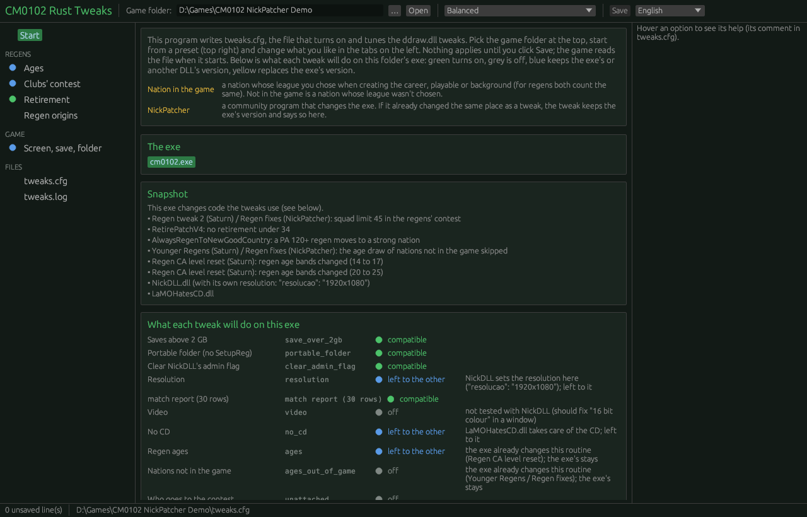
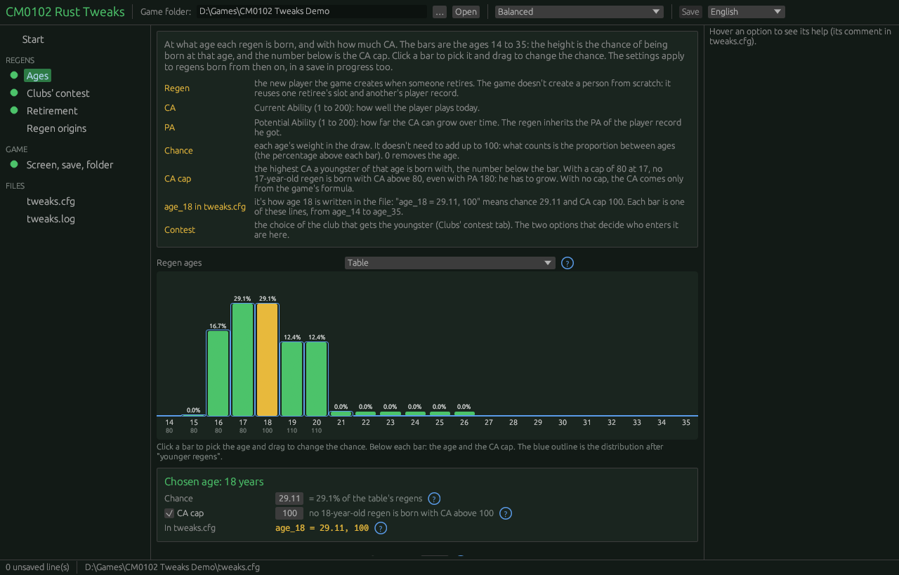
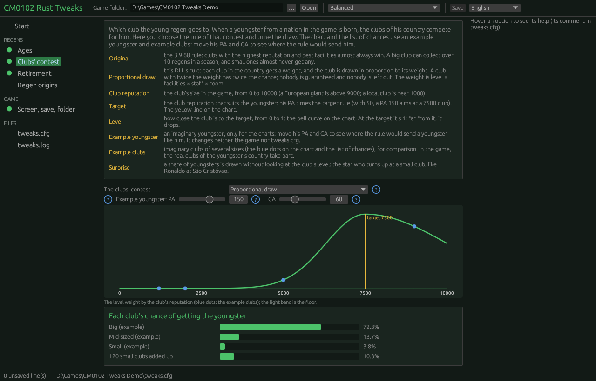
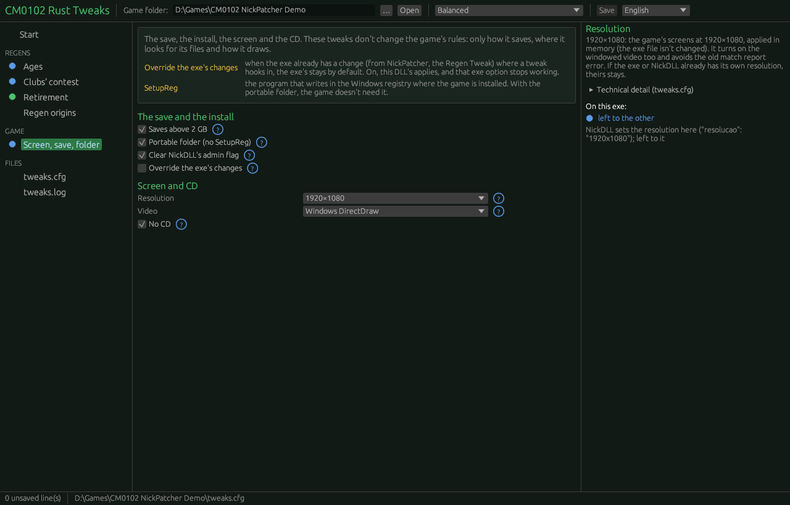
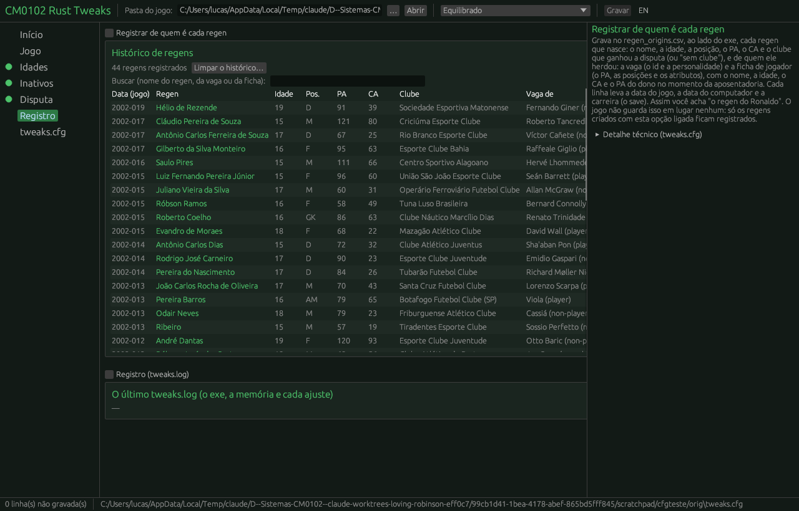

# O configurador: projeto da interface

*English version: [CONFIGURADOR.en.md](CONFIGURADOR.en.md)*

Projeto da Fase 3 do [ROADMAP](../ROADMAP.pt.md): o programa que edita o `tweaks.cfg` com barras, gráficos e o estado do exe. O projeto, a maquete e, desde 02/11, o protótipo do programa (§10). A maquete interativa, que abre no navegador, está em [configurador_maquete.html](configurador_maquete.html). Escrito em 02/11/2026.

Fontes: `tweaks.cfg`, `src/lib.rs` (`Regras`, `PADRAO`, `ler_regras`, as `Parte` e `pode_ligar`), `src/exe/retrato.rs`, `src/jogo/pasta.rs`, [TESTES.md](TESTES.md). As faixas abaixo são as do código; onde o código não limita, a faixa é **proposta** (ou "a definir") e está marcada assim.

## 1. Os princípios

- **Um `.exe` só** (`tweaks-config.exe`), separado da DLL, sem instalador e sem nada instalado antes. Abre ao lado do exe do jogo, ou pede a pasta.
- **O `tweaks.cfg` é a única fonte.** O configurador lê o arquivo, mostra e grava de volta trocando só o valor das linhas mudadas. Comentários, ordem, linhas em branco e chaves que ele não conhece ficam como estão (§5).
- **Barra e campo andam juntos.** Toda opção numérica tem uma barra de arrastar e um campo de digitação ligados: mexer num move o outro.
- **Ajuda ao lado.** A ajuda de cada opção é o comentário dela no próprio `.cfg`. Aparece no painel da direita ao passar o mouse ou ao focar o controle.
- **Ver antes de gravar.** Gráficos que mudam enquanto o usuário arrasta: as idades, a curva do nível, a chance de cada clube e a chance de aposentadoria.
- **O exe primeiro.** Para o exe escolhido, cada ajuste diz o que vai acontecer: liga, fica com a do exe ou não serve (§6).
- **Visual próprio.** Nada da interface do NickPatcher (formulário cinza com abas de caixas de seleção). Fundo escuro de gramado à noite, um acento verde, cartões por ajuste e gráficos grandes.

## 2. A janela

```
┌──────────────────────────────────────────────────────────────────────────────────────┐
│ CM0102 Rust Tweaks   Exe: [cm0102.exe ▾ CLZ (NickPatcher)]  Predefinição: [Equilibrado ▾]  [Gravar] │
├────────────┬─────────────────────────────────────────────────────┬───────────────────┤
│ Início     │                                                     │ Ajuda             │
│ Jogo       │   cartões da aba escolhida                          │ (o comentário do  │
│ Idades     │   (interruptores, barras+campo, gráficos)           │  .cfg da opção    │
│ Inativos   │                                                     │  sob o mouse)     │
│ Disputa    │                                                     │                   │
│ Registro   │                                                     │ Neste exe:        │
│ tweaks.cfg │                                                     │ ● liga            │
├────────────┴─────────────────────────────────────────────────────┴───────────────────┤
│ 3 mudanças não gravadas · tweaks.cfg em D:\Jogos\CM0102 · última leitura do tweaks.log: 02/11 21:40 │
└──────────────────────────────────────────────────────────────────────────────────────┘
```

- **Barra de cima:** o exe escolhido (lista com os `.exe` da pasta), a predefinição (§4) e Gravar. A predefinição mostra "Personalizado" quando os valores não batem com nenhuma.
- **Esquerda:** as abas, cada uma com um ponto colorido com o pior estado dos ajustes ligados dela naquele exe (§6.1: verde ✅, amarelo ⚠️, azul 🔁, vermelho ❓, cinza desligado). Acima de tudo, a faixa de aviso quando há ⚠️ ou ❓.
- **Direita:** a ajuda e o estado do ajuste no exe (§6).
- **Rodapé:** mudanças pendentes, caminho do `.cfg`, e se há um `tweaks.log` recente (§6.3).

## 3. As abas e os controles

Colunas: **Controle**; **Aceita** (o que `ler_regras` aceita, com os limites do código); **Barra** (a faixa da barra); **Sem a linha** (o padrão da DLL, `PADRAO`); **No .cfg** (o valor do `tweaks.cfg` distribuído).

Regra das faixas: o **campo** aceita a faixa válida inteira. A **barra** cobre a parte útil e fica encostada no fim quando o valor passa dela. Nas chaves sem limite no código, a faixa válida é a proposta (decisão do Lucas, §9).

Os interruptores gravam sempre `1` ou `0`, porque a DLL só liga com `v == "1"` exato (`log` liga com qualquer número diferente de 0). Os seletores gravam a palavra exata que a DLL testa (`custom`, `new`, `table`, `only_if_no_room`); qualquer outra palavra vale como o original.

### 3.1 Início

Sem controles de valor. Mostra:
- o **retrato do exe**: nome, tamanho, se é o 3.9.68 intacto ou quantas funções e blocos mudaram, seções novas (a `.nick` do CLZ), os casos conhecidos pelo nome (a tabela `CONHECIDOS` de `retrato.rs`);
- a **tabela "o que cada ajuste vai fazer"** (§6), uma linha por ajuste, com o estado, o motivo, o nome do patch e o botão "ir para a aba";
- as DLLs achadas ao lado do exe (`NickDLL.dll`, `LaMOHatesCD.dll`) e, com a NickDLL, o `"resolucao"` do `NickDLL_config.json`;
- a predefinição em uso e as diferenças para ela.

### 3.2 Jogo (save, pasta, administrador, sobrescrever)

| Chave | Controle | Aceita | Barra | Sem a linha | No .cfg |
|---|---|---|---|---|---|
| `save_over_2gb` | interruptor | `1` liga, o resto desliga | — | 0 | 1 (desde a 1.3) |
| `portable_folder` | interruptor | idem | — | 0 | 0 |
| `clear_admin_flag` | interruptor (com aviso "só serve com a NickDLL" quando não há `NickDLL.dll` na pasta) | idem | — | 0 | 0 |
| `override_exe_changes` | interruptor com confirmação ("substituir as mudanças do exe pelas regras desta DLL") | idem | — | 0 | 0 |
| `video` | seletor (original / janela) | `window` liga, o resto desliga | — | original | original |
| `resolution` | seletor (original / 1920×1080); com 1080, o `video` aparece ligado e travado | `1080` liga, o resto desliga | — | original | original |
| `no_cd` | interruptor | `1` liga, o resto desliga | — | 0 | 0 |

- `resolution = 1080` **liga e trava o `video`**: quando a resolução vale neste exe, o seletor do vídeo fica em "janela", cinza, com a nota "ligado pela resolução" (a DLL liga a janela sozinha; o `.cfg` continua com o `video` que o usuário escolheu). Quando a resolução fica com outro (a NickDLL) ou não serve, o vídeo volta a seguir o próprio seletor.
- O cartão da resolução mostra também o estado da **trava das 30 linhas** do relatório da partida (`Area::init`), que a DLL acrescenta com `resolution`, `video` ou a resolução da NickDLL, sem chave própria.

### 3.3 Idades

Um cartão "**Nação no jogo**" no topo (§7) e depois:

| Chave | Controle | Aceita | Barra | Sem a linha | No .cfg |
|---|---|---|---|---|---|
| `ages` | seletor de dois: "Tabela" (`custom`) / "Original" (`original`) | `custom` liga | — | original | custom |
| `age_14` … `age_35` | **gráfico de barras arrastáveis** (a chance) + campo da barra escolhida + campo do teto do CA | chance: número, negativo vira 0, sem máximo; teto: inteiro (o `.cfg` diz 1 a 200), sem teto = omitido | chance 0–40 (proposta) | a tabela original: 15 = 0,0025; 16 = 16,67; 17 e 18 = 29,11; 19 e 20 = 12,44; 21 a 26 = 0,04; o resto 0 | igual |
| `younger_from_age` | barra + campo | inteiro, sem limite no código | 14–35 (proposta) | 22 | 22 |
| `younger_by` | barra + campo ("0 = desligado") | inteiro ≥ 0 | 0–15 (proposta) | **0** | 6 |
| `ages_out_of_game` | seletor: "Sorteio original" / "A tabela também" | `table` | — | original | original |
| `ca_cap_skip` | barra + campo, em % | número, sem limite (é %) | 0–100 (proposta: 0–5 na barra) | 0,5 | 0,5 |
| `contest_max_age` | barra + campo; cinza quando `unattached = only_if_no_room` (ali não conta) | inteiro 0–126 | 14–25 (proposta) | 18 | 18 |
| `unattached` | seletor: "Original" / "Sem clube só sem vaga" | `only_if_no_room` | — | original | original |

**O gráfico das idades** (o centro da aba):
- 22 barras, de 14 a 35 anos. A altura é a chance relativa; o rótulo, a porcentagem normalizada (as chances não precisam somar 100). Escala de raiz quadrada, para que 0,04 apareça ao lado de 29,11.
- Arrastar a barra para cima ou para baixo muda a chance. Clicar escolhe a idade: abaixo do gráfico, barra + campo da chance e campo do teto do CA (vazio = sem teto).
- Abaixo de cada barra, o teto do CA (80, 100, 110...) num selo.
- **Sobreposição "depois de regens mais novos":** contornos que mostram a distribuição final quando `younger_by > 0` (quem sai com `younger_from_age` anos ou mais desce `younger_by` anos). Muda ao arrastar as duas barras.
- `ages = original` deixa o gráfico cinza com o aviso "a tabela não vale: o jogo usa as idades do 3.9.68".

### 3.4 Inativos

| Chave | Controle | Aceita | Barra | Sem a linha | No .cfg |
|---|---|---|---|---|---|
| `retire_idle_players` | interruptor | `1` liga | — | 0 | 1 |
| `idle_days` | barra + campo, em dias | inteiro ≥ 0 | 0–730 (proposta) | 180 | 180 |
| `idle_min_age` | barra + campo | inteiro, sem limite no código | 16–40 (proposta) | 28 | 28 |
| `idle_rep` | barra + campo | número ≥ 0 | 0–10000 (proposta) | 1500 | 1500 |
| `idle_rep_per_year` | barra + campo | número ≥ 0 | 0–2000 (proposta) | 250 | 250 |
| `protect_young_unemployed` | barra + campo ("0 = sem proteção") | inteiro ≥ 0 | 0–30 (proposta) | 0 | 0 |

**Gráfico:** chance de aposentar por verificação (o jogo verifica nos dias 0, 80, 173 e 250 do ano), por idade de 18 a 40, para uma reputação de exemplo (barra própria, 500 a 10000, começa em 3000):
- a partir de `idle_min_age`: `mín(1, (idle_rep + idle_rep_per_year × (idade − idle_min_age)) / reputação)`, depois de `idle_days` sem clube (linha cheia);
- abaixo de `idle_min_age`: a regra original, `mín(1, 750 / reputação)` depois de 365 dias (tracejada);
- abaixo de `protect_young_unemployed`: zero;
- desligado: só a tracejada, em todas as idades.

Com reputação 3000 e o `.cfg` distribuído, o gráfico tem de dar 50% aos 28, 75% aos 31 e 100% aos 34 (o exemplo do próprio `.cfg`). Uma nota lembra a outra regra do original (passou do limite de idade da posição), que não muda.

### 3.5 Disputa (regens)

| Chave | Controle | Aceita | Barra | Sem a linha | No .cfg |
|---|---|---|---|---|---|
| `rule` | seletor: "Sorteio proporcional" (`new`) / "Original" | `new` liga | — | original | new |
| `target_k` | barra + campo | número, sem limite | 0–100 (proposta) | 50 | 50 |
| `target_ca` | barra + campo ("0 = PA, 1 = CA") | número, sem limite (sentido 0–1) | 0–1 | 0 | 0 |
| `sigma` | barra + campo | número ≥ 1 | 100–10000 (proposta) | 2500 | 2500 |
| `sigma_below` | barra + campo ("0 = igual a sigma") | número ≥ 0 | 0–10000 (proposta) | 1200 | 1200 |
| `level_floor` | barra + campo | número, sem limite (o `.cfg` diz 0 a 1) | 0–0,05 na barra, 0–1 no campo (proposta) | 0,002 | 0,002 |
| `facilities_base` | barra + campo | número, sem limite | 0–2 (proposta) | 0,4 | 0,4 |
| `facilities_k` | barra + campo | número, sem limite | 0–0,2 (proposta) | 0,06 | 0,06 |
| `staff_min` | barra + campo | número, sem limite | 0–2 (proposta) | 0,8 | 0,8 |
| `staff_max` | barra + campo (aviso se menor que `staff_min`) | número, sem limite | 0–2 (proposta) | 1,2 | 1,2 |
| `squad_limit` | barra + campo | 1–50 (o código limita) | 20–50 | 48 | 48 |
| `squad_exp` | barra + campo | número, sem limite | 0–3 (proposta) | 0,5 | 0,5 |
| `season_cap` | barra + campo ("0 = sem teto") | número, sem limite | 0–10 (proposta) | 2 | 2 |
| `surprise` | barra + campo, em % | 0–100 (o código limita) | 0–50 | 15 | 15 |
| `temperature` | barra + campo | número, sem limite | 0,25–3 (proposta) | 1 | 1 |

Três desenhos, ao vivo:
1. **A curva do nível.** Eixo x: reputação do clube, 0 a 10000. Eixo y: peso do nível, 0 a 1. Uma linha vertical no alvo (`target_k × ((1 − target_ca) × PA + target_ca × CA)`), a curva assimétrica (`sigma_below` à esquerda, `sigma` à direita) e o piso (`level_floor`) como faixa clara no fundo. Os clubes do exemplo aparecem como pontos sobre a curva. O jovem de exemplo tem PA e CA em barras próprias (PA 150, CA 60).
2. **Instalações e comissão** em uma linha de texto que muda: "Training 1 = 0,46 · 10 = 1,00 · 20 = 1,60" e "pior treinador 0,80 · melhor 1,20".
3. **Chances por clube.** Barras horizontais com a chance de cada clube de exemplo receber o jovem, com a mesma conta de `peso()` em `lib.rs` (nível × instalações × comissão × vaga, elevado a `temperature`; fora quem tem elenco ≥ `squad_limit` ou já recebeu `season_cap`). A surpresa é misturada: `(1 − s) × normal + s × surpresa`, a surpresa sem o nível e só entre os clubes de competição. A regra original (o maior sorteio(nota)) não é desenhada: é outra conta, e o exemplo mostra só a nova.

Os clubes do exemplo são fictícios e marcados assim ("exemplo"): um grande, um médio, um pequeno e "120 clubes pequenos somados", para mostrar por que `sigma_below` e `level_floor` existem (as centenas de clubes pequenos, somadas, levam os jovens). Melhoria futura: carregar os clubes reais de um save, como o `tools/regens/calibrar.py` (§9).

`rule = original` deixa os três desenhos cinza com o aviso "o jogo usa a disputa do 3.9.68".

### 3.6 Registro

| Chave | Controle | Aceita | Sem a linha | No .cfg |
|---|---|---|---|---|
| `log` | interruptor | qualquer número ≠ 0 liga; grava 1 ou 0 | 0 | 0 |

A aba mostra a ajuda das linhas do log (o próprio comentário do `.cfg`) e, se houver um `tweaks.log` na pasta, as linhas `exe`, `runtime` e de cada ajuste da última abertura (§6.3).

### 3.7 tweaks.cfg

O arquivo como vai ficar, com as linhas mudadas destacadas e, no topo, "N linhas mudadas, M acrescentadas, nenhuma apagada". Somente leitura. Botões: Gravar e Desfazer tudo (volta ao lido do disco).

## 4. As predefinições

As predefinições mexem nos grupos de jogo (idades, inativos, disputa) e, só a "Só o save", no `save_over_2gb`. Não mexem em `portable_folder`, `clear_admin_flag`, `override_exe_changes` e `log`, que dependem da instalação e não do gosto.

| Chave | Original | Só o save | Equilibrado | Equilibrado, todos com clube |
|---|---|---|---|---|
| `save_over_2gb` | (não mexe) | 1 | (não mexe) | (não mexe) |
| `ages` | original | original | custom | custom |
| tabela `age_NN` | (não mexe) | (não mexe) | a original | a original |
| `younger_from_age`, `younger_by` | (não mexe) | (não mexe) | 22, 6 | 22, 6 |
| `ages_out_of_game` | original | original | original | original |
| `ca_cap_skip`, `contest_max_age` | (não mexe) | (não mexe) | 0,5, 18 | 0,5, 18 |
| `unattached` | original | original | original | **only_if_no_room** |
| `retire_idle_players` | 0 | 0 | 1 | 1 |
| inativos (dias, idade, rep, por ano, proteção) | (não mexe) | (não mexe) | 180, 28, 1500, 250, 0 | idem |
| `rule` | original | original | new | new |
| disputa (`target_k` … `temperature`) | (não mexe) | (não mexe) | os da Fase 1 (o `.cfg` distribuído) | idem |
| `intake` | 0 | 0 | **1** | **1** |
| fornada (`intake_per_club`, `intake_day`, `intake_clubs`) | (não mexe) | (não mexe) | 3, season_end, playable | idem |

- **Original:** a DLL não muda nada no jogo; os números ficam como estão porque não valem com os interruptores desligados.
- **Só o save:** para quem vinha do `cm0102-save2gb`.
- **Equilibrado:** o `tweaks.cfg` distribuído, decidido e calibrado na Fase 1; desde a 1.3, com a fornada ligada (a carreira de 10 anos com todas as ligas em [PESSOAS_NOVAS.md](PESSOAS_NOVAS.md) §8).
- **Equilibrado, todos com clube:** o das carreiras longas de [TESTES.md](TESTES.md) §4.3 (os regens sem clube caem de 899 para 353 na fábrica e de 233 para 77 no CLZ).

Ao escolher uma predefinição, a interface mostra a lista de mudanças antes de aplicar ("12 valores vão mudar") e permite desfazer.

## 5. Ler e gravar sem apagar os comentários

O `.cfg` é lido como lista de linhas, nunca reconstruído do zero. O algoritmo:

**Ler**
1. Ler o arquivo como bytes; guardar o fim de linha usado (`\r\n` ou `\n`) e se o arquivo termina com quebra.
2. Para cada linha `i`: `codigo = parte antes do primeiro '#'`. Se `codigo` tem `=`, `chave = trim(antes)`, `valor = trim(depois)`. Guardar `posicao[chave] = i`. **A última ocorrência vence**, como na DLL (o laço de `ler_regras` sobrescreve).
3. Interpretar cada valor exatamente como `ler_regras` (`1` exato nos interruptores, `custom`/`new`/`table`/`only_if_no_room` nos seletores, número com ponto). Valor que a DLL não entenderia (`sigma = abc`) aparece com aviso "a DLL ignora esta linha e usa o padrão".
4. A ajuda de cada chave: as linhas de comentário logo acima dela, até a primeira linha em branco ou de chave; se não houver nenhuma (como `idle_days`), a ajuda da chave anterior do mesmo bloco.

**Gravar**
1. Para cada chave mudada que já tem linha: trocar só o trecho do valor. Expressão: `^(\s*CHAVE\s*=\s*)([^#]*?)(\s*(#.*)?)$` → `$1 + novo + $3`. Espaços e comentário no fim da linha ficam.
2. Para cada chave mudada **sem** linha: acrescentar só se o novo valor for diferente do padrão da DLL sem a linha (o arquivo não cresce à toa). Inserir logo depois da linha da chave anterior na ordem do `.cfg` distribuído que exista no arquivo (as idades, em ordem de idade); se nenhuma existir, no fim, sob `# added by the configurator`.
3. Nunca apagar linha. Tirar uma idade = `age_NN = 0` (o que o próprio `.cfg` manda). Chaves desconhecidas e linhas comentadas ficam intactas.
4. Formato dos números: ponto decimal, sem zeros sobrando (até 4 casas; `0.0025` fica `0.0025`). Idade: `chance, teto` ou só `chance` sem teto.
5. Gravar em `tweaks.cfg.tmp`, copiar o anterior para `tweaks.cfg.bak` e renomear (troca atômica). Se o arquivo mudou no disco desde a leitura (data ou tamanho), perguntar antes.
6. Sem `tweaks.cfg` na pasta: criar a partir do `.cfg` distribuído, embutido no exe (`include_str!`), com os valores aplicados. Esse mesmo texto embutido dá a ajuda quando o arquivo do usuário não tem comentários.

Teste de aceitação: ler o `tweaks.cfg` distribuído e gravar sem mudar nada dá o mesmo arquivo, byte a byte. A maquete faz o mesmo processo em JavaScript na aba tweaks.cfg.

## 6. O estado do exe

Os estados, a matriz por exe e o que as DLLs do CLZ mudam estão em [COMPATIBILIDADE.md](COMPATIBILIDADE.md); o aviso para quem usa o NickPatcher, em [NICKPATCHER.md](NICKPATCHER.md). O configurador mostra exatamente aqueles estados, com o motivo e o nome do patch, ajuste por ajuste. A regra de lá vale aqui: **fazer o possível**. Cada ajuste é conferido sozinho, e o que não serve fica de fora sem barrar os outros.

### 6.1 Os quatro estados (COMPATIBILIDADE.md §1)

| Estado | Quando | Cor | O que o configurador mostra |
|---|---|---|---|
| ✅ **compatível** | o trecho está como no 3.9.68, ou o exe já tem esta mesma mudança | verde | o motivo, quando há (ex.: "o exe tem 5 dos 201 trechos já trocados; a DLL completa os outros") |
| ⚠️ **sobrescreve** | o exe tem uma mudança **conhecida** no trecho e `override_exe_changes = 1` manda trocá-la pela nossa | amarelo | o nome da mudança e o que se perde |
| 🔁 **fica com o outro** | uma mudança **conhecida** faz o mesmo papel; a nossa fica de fora e vale a do exe ou da outra DLL | azul | o nome (Regen Tweak, NickDLL, LaMOHatesCD); nos casos de `override_exe_changes`, o botão "usar as regras desta DLL" |
| ❓ **desconhecido** | o trecho difere do 3.9.68 de um jeito que o catálogo não reconhece; só este ajuste fica de fora | vermelho | quantos trechos e onde; o pedido para mandar o `tweaks.log` |

Um ajuste desligado no `.cfg` aparece em cinza ("desligado") e não conta. "Conhecido" = nomeado pelo retrato do exe (`CONHECIDOS` em `src/exe/retrato.rs`), pelo catálogo do NickPatcher (`tools/exe/retrato_exe.py`) ou por COMPATIBILIDADE.md.

**Aviso geral:** quando algum ajuste ligado está em ⚠️ ou ❓, uma faixa no topo da janela diz "atenção: X ajustes não são compatíveis com este exe/patch", com os nomes e o atalho para a tabela do Início. O ponto colorido de cada aba mostra o pior estado entre os ajustes ligados dela.

### 6.2 Como o configurador calcula

Sem rodar o jogo, em três fontes:

1. **O arquivo do exe**, com as mesmas conferências da DLL, lendo do disco em vez da memória (os VA convertidos em deslocamento pelas seções do PE):
   - para cada `Parte` de `lib.rs` (`SAVE`, `IDADE`, `IDADE_FORA`, `DISPUTA`, `INATIVOS`, `SEM_CLUBE`), o FNV-1a de 64 bits das **bordas** e do **corpo**. Bordas diferentes → ❓. Corpo igual → ✅. Corpo diferente → 🔁 ou ⚠️ (por `override_exe_changes`) se a mudança for conhecida, ❓ se não for;
   - para as **trocas** (`aplicar_trocas`: as 201 da resolução e as 33 do CD, em `src/video/trocas.rs`), cada trecho é contado como "como no 3.9.68", "já trocado" ou "estranho". Na resolução, um estranho recusa a lista toda (❓), porque meia lista daria telas quebradas. No CD, cada checagem vale sozinha, e as estranhas só ficam de fora. "Já trocado" é ✅ (o exe já tem);
   - a **trava das 30 linhas**: os 6 bytes da entrada do `Area::init` (0x402ac0) como no 3.9.68;
   - o **vídeo**: `ChangeDisplaySettingsA` na tabela de importações;
   - o **retrato do disco** (`retrato.rs`: funções e blocos contra `referencia.rs`, seções novas, `CONHECIDOS`) no cartão do Início.
2. **A pasta do exe**, como `ligar_tela` faz:
   - `LaMOHatesCD.dll` ao lado → `no_cd` 🔁 (fica com ela);
   - `NickDLL.dll` com a marca `layout Nick Patcher` e `"resolucao"` diferente de `800x600` no `NickDLL_config.json` → `resolution` 🔁 (fica com a NickDLL), a mesma leitura de `resolucao_da_nickdll`. O Início mostra o valor lido. Com a resolução da NickDLL, a trava das 30 linhas entra mesmo sem `resolution`;
   - `NickDLL.dll` presente → a nota de `clear_admin_flag` ("útil aqui").
3. **O último `tweaks.log`** da pasta, para o que só aparece **em memória**. A NickDLL e a LaMOHatesCD mudam o exe ao rodar (1.205 trechos no CLZ): o time B (0x540a50), a caixa de mensagem (0x5e8290). O configurador mostra as linhas `runtime` (avisos e notas), `check` e a linha de cada ajuste, com a data. Se a previsão e o log discordam, o painel mostra a diferença. Os casos que só o log ou a matriz conhecem (o `log = 1` e a caixa de mensagem no CLZ 6.1, ⚠️ [inferência]) vêm da matriz de COMPATIBILIDADE.md §2, embutida no configurador.

Para não duplicar as tabelas, as `Parte`, as trocas e a `referencia.rs` passam a um módulo comum, usado pela DLL e pelo configurador (decisão do Lucas, §9).

### 6.3 Os exemplos da maquete (a matriz de COMPATIBILIDADE.md §2)

| Ajuste | 3.9.68 | Regen Tweak | CLZ 6.1 (NickPatcher + NickDLL do 6.1 + LaMOHatesCD) | Exe com patch desconhecido |
|---|---|---|---|---|
| `save_over_2gb` | ✅ | ✅ | ✅ (a NickDLL chama a 0x933610, que o ajuste não troca) | ✅ |
| `portable_folder`, `clear_admin_flag` | ✅ | ✅ | ✅ feitos para o CLZ | ✅ |
| `ages` | ✅ | ✅ | 🔁 faixas raras do NickPatcher; ⚠️ com override 1 | ✅ |
| `ages_out_of_game` | ✅ | ✅ | 🔁 ramo pulado; ⚠️ com override 1 (continua sem rodar) | ✅ |
| `rule = new` | ✅ | 🔁 Regen Tweak; ⚠️ com override 1 | 🔁 / ⚠️ igual; a NickDLL troca o time B, e a disputa a usa | ❓ corpo sem nome no catálogo |
| `retire_idle_players` | ✅ | ✅ | ✅ com a nota do RetirePatchV4 | ✅ |
| `unattached` | ✅ | ✅ | ✅ | ✅ |
| `no_cd` | ✅ | ✅ | 🔁 fica com a LaMOHatesCD | ✅ |
| `resolution = 1080` | ✅ | ✅ | 🔁 fica com a NickDLL quando `"resolucao"` ≠ 800x600; senão ✅ (o exe tem 5 dos 201 trechos, a DLL completa) | ❓ 3 dos 201 trechos com outro patch: nada trocado |
| trava das 30 linhas | ✅ | ✅ | ✅ | ✅ |
| `video = window` | ✅ | ✅ | ❓ não testado ("16 bit colour") | ✅ |
| `log = 1` | ✅ | ✅ | ⚠️ a NickDLL e a LaMOHatesCD também desviam a 0x5e8290 [inferência] | ✅ |

O exe com patch desconhecido é inventado, para mostrar o ❓. Na maquete, o seletor do Início troca o `"resolucao"` do `NickDLL_config.json` do CLZ (800x600 → a nossa resolução ✅; outra → 🔁).

## 7. "Nação no jogo"

Um cartão fixo no topo das abas Idades e Disputa, com um desenho de três fichas:

```
 Ao criar a carreira, você escolhe ligas:
 [ Jogável ]  byte 2  ─┐
 [ De fundo ]  byte 1  ─┴─▶  NAÇÃO NO JOGO   (para os regens, as duas contam igual)
 [ Não escolhida ] 0   ───▶  FORA DO JOGO
```

Texto: "Nação no jogo é aquela cuja liga você escolheu ao criar a carreira, jogável ou de fundo. Para os regens as duas contam igual: o jogo só olha se o byte `NationLeagueSelected` não é 0. Fora do jogo é a nação cuja liga não foi escolhida." E onde importa:
- **idades:** as nações fora do jogo com menos de 350 pessoas no banco têm o sorteio próprio (`ages_out_of_game`);
- **quem vai à disputa:** só os jovens de nação no jogo (`contest_max_age`, `unattached`);
- **disputa:** os jovens de nação fora do jogo seguem o caminho original, sem o teto por clube (o acúmulo de [TESTES.md](TESTES.md) §4.3, o AS Douanes).

## 8. A tecnologia

| Opção | Exe único sem dependências | Gráficos arrastáveis | Contra |
|---|---|---|---|
| **Rust + eframe/egui** | sim: CRT estática (`+crt-static`), uns 4 a 8 MB, nada instalado | fácil: desenho imediato, `Plot`/`Painter`, arrastar é um `Response` | visual próprio (não nativo do Windows), mas aqui isso é o que se quer |
| Rust + Win32 nativo (`native-windows-gui` ou `windows`) | sim, e menor (menos de 1 MB) | difícil: gráficos e arrastar desenhados à mão em GDI | trabalho grande na parte que mais importa (os gráficos); aparência de formulário do Windows, perto da do NickPatcher |
| Tauri (HTML/JS) | não: depende do WebView2 (vem no Windows 10/11 atualizado, mas não em todo lugar) | fácil (a maquete viraria o programa) | o Lucas já disse que não precisa ser Tauri; dependência de sistema |

**Recomendação: Rust + eframe/egui.** É a mesma linguagem do projeto, pode reaproveitar as `Parte`, a `referencia.rs` e a lógica do `peso()` (os exemplos ficam idênticos à DLL), sai num exe só e desenha gráficos interativos sem esforço. Detalhes a confirmar num protótipo:
- o renderizador: o `wgpu` (DirectX 12, com o adaptador de software WARP como reserva) evita depender do driver OpenGL das máquinas antigas; o `glow` (OpenGL) é menor. Testar numa máquina virtual sem placa de vídeo antes de decidir;
- o alvo: `x86_64-pc-windows-msvc` cobre quase todos; i686 só se alguém pedir;
- fontes: as padrão do egui cobrem português, turco e o resto do Latin; embutir uma fonte própria só se o visual pedir.

## 9. Decisões que dependem do Lucas

1. **Tecnologia:** egui (recomendada) ou outra.
2. **Faixas propostas** das chaves sem limite no código (marcadas "proposta" no §3) e a regra "a barra cobre a parte útil, o campo aceita tudo".
3. **Predefinições:** os nomes, se "Equilibrado" já deve vir com `unattached = only_if_no_room` (as carreiras longas usaram), e se uma predefinição pode mexer no `save_over_2gb`.
4. **Idioma da interface:** inglês e português com troca, ou só inglês na abertura. A ajuda é o comentário do `.cfg`, que está em inglês; traduzir a ajuda exige o texto em português embutido.
5. **Módulo comum** entre DLL e configurador (`Parte`, `referencia.rs`, `peso()`), num workspace Cargo no mesmo repositório, ou cópia.
6. **Clubes do exemplo:** fictícios (como na maquete) ou lidos de um save do usuário (como o `calibrar.py`), numa versão seguinte.
7. **O `video` travado pela resolução:** mostrar "janela" travada (como na maquete) ou gravar também `video = window` no `.cfg`.
8. **Onde fica o configurador:** no mesmo zip da DLL (`tweaks-config.exe` ao lado de `ddraw.dll` e `tweaks.cfg`), sugerido.

## 10. O programa (protótipo de 02/11/2026)

`configurador/` é o programa: Rust com eframe/egui (renderizador `glow`), alvo i686 com a CRT estática, um `tweaks-config.exe` só, de uns 4,5 MB. Compilar: `cd configurador && cargo build --release`; testes: `cargo test --release` (a ida e volta do `.cfg` byte a byte, a troca só do valor, a última linha que vence, a chave nova no lugar certo).

- `src/cfg.rs`: ler e gravar o `.cfg` como no §5 (só o valor muda; `.bak` e troca atômica; recusa gravar se o arquivo mudou no disco).
- `src/chaves.rs`: as chaves, as faixas, os padrões da DLL e as quatro predefinições do §4.
- `src/exe.rs`: o estado de cada ajuste no exe (§6), com as **mesmas** tabelas da DLL: `src/exe/partes.rs` (as `Parte`, as assinaturas e os casos conhecidos, agora fora do `lib.rs`) e `src/video/trocas.rs`, incluídos pelo caminho, sem cópia.
- `src/main.rs`: a janela (§2) e as abas (§3), no menu da esquerda em grupos (03/11, pedido do Lucas, reorganizado no mesmo dia): o **Início**, com o retrato e a tabela de estados (o nome da opção e a chave em cinza); **Ajustes da carreira**: Fornada de regens (as chaves `intake_*`, desde a 1.2; a primeira desde a 1.3, quando passou a vir ligada), Idades dos regens (o gráfico arrastável, o contorno dos "regens mais novos" e a idade escolhida por extenso: a chance, a porcentagem, o teto do CA e a linha `age_NN` como fica no `.cfg`), Disputa dos clubes (a curva do nível e as chances dos clubes de exemplo, a mesma conta de `peso()`), Aposentadoria (a chance de aposentar por idade), Nomes dos regens (a escolha, o mínimo e, lida do banco da pasta do jogo, a lista dos países que pegam nomes emprestados: de que país vêm hoje e se passam a usar os próprios; `src/regens/nomes.rs`) Jogadores cinzentos (a escolha, a barra "± N" da variação e os exemplos da carreira de teste), Público e estádio (branch estudos: o interruptor do público e o do estádio, cada chave com a frase do efeito, o custo por lugar em três modos (o do jogo, automático pelo caixa do banco, um valor fixo) e um clube de exemplo com a temporada seguinte, os tetos de cada jogo e a obra); **Registro**: De quem é cada regen (o histórico); **Instalação**: Tela, save e pasta; **Arquivos**: tweaks.cfg (as linhas mudadas) e tweaks.log (o último log). Português e inglês.

**Nenhum número sem explicação** (03/11, pedido do Lucas): embaixo de cada opção com número, uma frase calculada na hora diz o que aquele valor faz no jogo, em unidades de quem joga ("um jovem de PA 150 mira um clube de reputação 7500", "0,5% = cerca de 1 em 200 jovens nasce sem o teto", "180 dias = uns 6 meses", "um clube com 24 jogadores tem ×1,73 a chance de um com 40"). Os números aparecem como se leem ("2", não "2.00"), com vírgula no português (`App::frase`). Na Disputa, o ajuste fino do sorteio (larguras, piso, instalações, comissão, peso da vaga, temperatura) fica num bloco **Avançado**, fechado, cada um com a sua frase. Na aba dos cinzentos, a barra mostra "± 5" e o `.cfg` guarda a largura toda (`grey_players_spread = 10`).

**O histórico de regens** (aba De quem é cada regen): quantos regens o `regen_origins.csv` tem, a busca pelo nome do regen, de quem herdou a vaga ou a ficha, e "Limpar o histórico" (guarda uma cópia datada ou apaga de vez, com confirmação).

**A ajuda:** cada aba abre com um cartão que diz para que ela serve e explica cada termo que ela usa (CA, PA, teto do CA, `age_NN`, sorteio proporcional, original, alvo, nível, jovem de exemplo, vaga, ficha...; `guia::intro` e `guia::termos`). Cada controle tem o nome do que faz (não a chave), um "?" ao lado que mostra a explicação ao passar o mouse (também com a opção desligada) e, no painel da direita, um texto prático em português e inglês: o que faz, quando usar e a consequência no jogo (`src/guia.rs`). A chave e o comentário técnico do `.cfg` ficam embaixo, em "Detalhe técnico". Os mesmos textos geram o [GUIA_DAS_CHAVES.md](GUIA_DAS_CHAVES.md) (`tweaks-config.exe --guia pt|en ARQUIVO`); um teste garante que toda chave tem os dois textos.

Decisões tomadas no protótipo (dá para mudar): egui com `glow`; alvo i686 (o mesmo da DLL; roda em qualquer Windows); o `video` travado pela resolução só aparece travado, sem gravar `video = window`; os clubes do exemplo são fictícios.

Feito depois: o diálogo de pasta do Windows (o botão "…", pela biblioteca `rfd`) e a lista de mudanças antes de aplicar uma predefinição. Falta: o teste numa máquina sem placa de vídeo (o `glow` precisa de OpenGL 2).

| | |
|---|---|
|  |  |
|  |  |
|  | |
